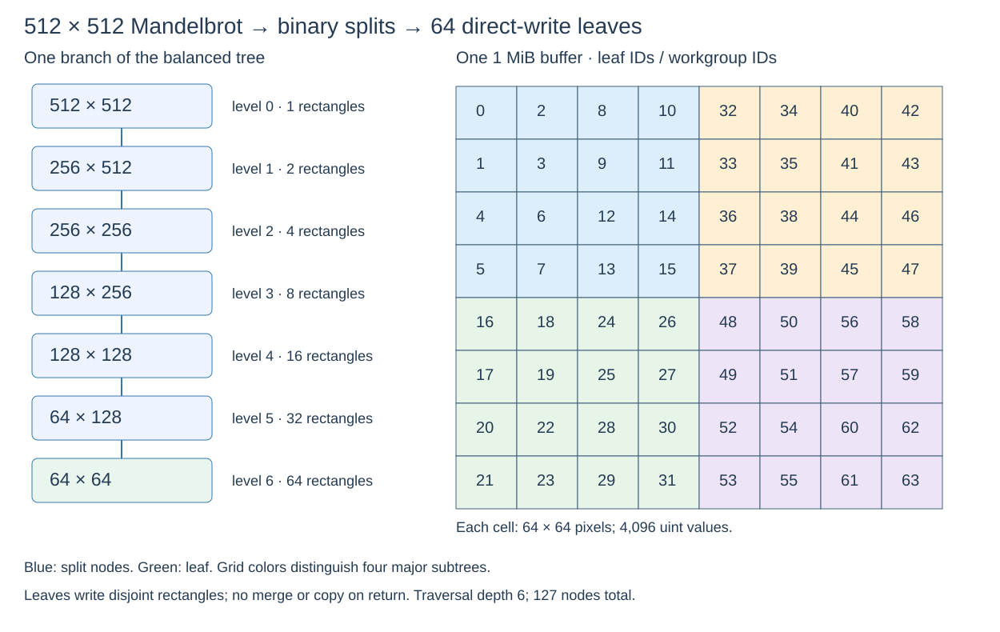

# 512×512 Mandelbrot: recursive subdivision and direct-write leaves

The experiment now uses a **512×512** baseline, split along the longer dimension until both dimensions are at most **64 pixels**. Equal sides split left/right first. This yields **six split levels, 127 total tree nodes, 64 leaf tiles, and one 1,048,576-byte output buffer**. Leaves write directly into their final buffer positions; returning from a child does not merge or copy pixels.



## The source actually compiled recursively

The [OpenCL source](../../tools/opencl-mandelbrot-study/mandelbrot_tiles.cl) contains a real, non-inlined `visit` function that calls itself twice after splitting a rectangle. The installed Intel compiler accepts it, produces `has_stack_calls: true` metadata, and emits a kernel-to-`visit` call, two calls back to `visit`, and a return instruction. This is actual device function recursion, not recursive host submission or a source macro that unrolls the tree.

There is a portability distinction: the [Khronos OpenCL C restrictions](https://registry.khronos.org/OpenCL/specs/unified/refpages/man/html/restrictions.html) explicitly exclude recursion. Acceptance by this Intel IGC toolchain therefore establishes compiler-specific output, not portable OpenCL support or successful execution. The compiler emits a stack-sizing warning, retained in the [recursive compilation log](opencl-mandelbrot-subdivision-20261024/recursive-ubuntu-host-default/compile.log).

The emitted recursive metadata reports `private_size: 33968`, `spill_size: 131072`, a 131,072-byte scratch spill/fill buffer and a 4,246-byte SIMT private-space entry. These are compiler allocation requirements, not measured live stack use. We have not validated device stack sufficiency, overflow behavior or runtime provisioning. A complete OpenCL runtime must satisfy the emitted ABI and allocations.

## Three ways to express the same leaf computation

| Strategy | What descends the tree | Suggested one-dimensional launch | Parallelism and storage |
|---|---|---|---|
| Actual recursion | `visit(left); visit(right)` in device code | One group: global 256, local 256 | Group visits leaves in depth-first order; pixels within each leaf are distributed among its 256 work-items. Uses compiler-managed call stack/scratch. |
| Explicit DFS stack | Iterative loop with `Tile pending[7]` | One group: global 256, local 256 | Same traversal; each work-item carries its own seven-node private stack. No recursive calls; private array storage is still reported. |
| Parallel leaves | Each group follows six bits of its leaf ID | 64 groups: global 16,384, local 256 | Groups independently derive their 64×64 rectangles on the GPU. No descriptor upload or per-tile host call; no recursive calls or reported private-memory buffer. |

The parallel version specializes the tree shape to 512×512. It preserves the same split decisions and final tiles, while avoiding a sequential visit to all leaves by one group. It does not dynamically enqueue children or implement a persistent GPU task queue. The recursive and DFS versions accept any positive width and height up to 512; extra groups return without work. All versions reject dimensions outside their stated contracts.

For a 64×64 leaf, 4,096 pixels divided over 256 work-items gives 16 pixels per work-item. Each work-item's Mandelbrot loop remains independent. SIMD lanes within a hardware thread are distinct from the 256 OpenCL work-items in a group.

## Compile results across the three GPUs

All **18 builds** passed offline binary validation and byte-identical IGA disassembly/reassembly: three strategies × three devices × default / requested SIMD8. Decoder version/metrics warnings remain in the logs.

| Strategy | Host A780 / rig 4680: default | Laptop 9A49: default | Requested SIMD8 |
|---|---|---|---|
| Actual recursive calls | SIMD8, 3,600-byte native image | SIMD8, 4,176-byte native image | Same widths and image sizes as default |
| Explicit DFS stack | SIMD32, 3,664 bytes | SIMD32, 3,664 bytes | SIMD8, 2,464 bytes on all three |
| Parallel leaves | SIMD32, 2,088 bytes | SIMD32, 2,088 bytes | SIMD8, 1,296 bytes on all three |

The recursive laptop image differs from the desktop/rig image. Within each DFS or parallel variant, native bytes match across all three targets. The explicit stack metadata reports private sizes of 3,584 / 896 for SIMD32 / SIMD8, with scratch entries of 4,096 / 1,024 bytes. The parallel version reports neither private nor scratch entries. Binary size and allocation differences are useful observations; they are not performance measurements.

A native function may appear **after kernel EOT**: the recursive `visit` entry is at byte `0x418` on the host/rig, beyond the wrapper's EOT. The extraction script now includes the image through the final function return rather than cutting it at the first EOT. ELF function symbols bound the image, and trailing compiler metadata/padding is excluded. Inter-function padding can remain inside the image span; static disassembly counts must not be interpreted as executed instruction counts.

Representative disassemblies and metadata:

- [Recursive host/rig SIMD8](opencl-mandelbrot-subdivision-20261024/recursive-ubuntu-host-default/kernel.asm) and [metadata](opencl-mandelbrot-subdivision-20261024/recursive-ubuntu-host-default/ze_info.yaml).
- [Recursive laptop SIMD8](opencl-mandelbrot-subdivision-20261024/recursive-laptop-default/kernel.asm).
- [DFS stack, compiler-selected SIMD32](opencl-mandelbrot-subdivision-20261024/stack-ubuntu-host-default/kernel.asm) and [requested SIMD8](opencl-mandelbrot-subdivision-20261024/stack-ubuntu-host-simd8/kernel.asm).
- [Parallel leaves, compiler-selected SIMD32](opencl-mandelbrot-subdivision-20261024/parallel-ubuntu-host-default/kernel.asm) and [requested SIMD8](opencl-mandelbrot-subdivision-20261024/parallel-ubuntu-host-simd8/kernel.asm).
- [All targets, exact commands, source/native hashes and metadata fields](opencl-mandelbrot-subdivision-20261024/results.json).

## Correctness checks performed

The [CPU harness](../../tools/opencl-mandelbrot-study/check_tiles.cpp) includes the actual OpenCL kernel source as C++, replacing only address-space/kernel annotations and the work-item ID builtins. It compares the three tiled paths against the original flat kernel, pixel-for-pixel. This is source simulation on the CPU, **not EU execution**.

For 512×512, origin (-2,-1.5), step 3/512, and iteration limit 64, all paths produce the same 1 MiB output, with FNV-1a64 **`a8c9cd05a9859ad0`**. Additional checks cover iteration limits zero/one; 1×1; 64×64; 65×1; 1×65; 65×65; 511×509; and 512×17. Output guards remain intact. Zero and oversized dimensions are rejected without writes.

A partition check using the source's split helper verifies 144 combinations of edge-case dimensions, with every pixel covered exactly once. The 512×512 traversal has exactly 127 nodes, 64 leaves, and a maximum of seven pending nodes. AddressSanitizer and UndefinedBehaviorSanitizer were enabled; leak detection was disabled because this execution environment prevents LeakSanitizer from operating. The [CPU check log](opencl-mandelbrot-subdivision-20261024/cpu-check.log) preserves the results.

These checks do not exercise EU floating-point behavior, SIMD masks, the OpenCL device ABI or GPU stack allocation. No GPU was dispatched, no rig/laptop was contacted, and no speedup is claimed.

## Reproduce

```sh
python3 tools/opencl-mandelbrot-study/study_tiles.py
```

This uses the same local Intel compiler libraries as the [initial compile study](opencl-mandelbrot-20261024.md). It builds all variants and runs the sanitized CPU-source harness. Full device binaries, SPIR-V, native images and validation logs remain under `bld/opencl-mandelbrot-recursion`.

A successful kernel completion is the point where the CPU can consume the shared output. Since leaf rectangles do not overlap and do not read one another's results, there is no inter-leaf merge or barrier in these kernels. A future algorithm with parent aggregation or shared mutable state would require a different dependency/ownership protocol.
