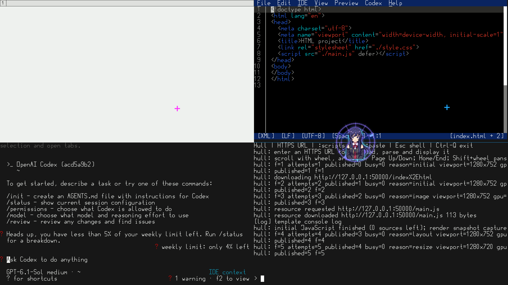
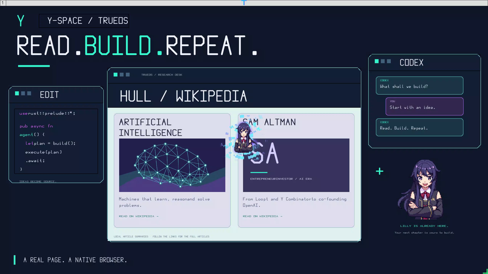

<h1 align="center">DOWNLOAD A &gt;25 MB PURE RUST KERNEL.</h1>
<h1 align="center">SIGN IN WITH YOUR CODEX ACCOUNT. VIBECODE YOUR DESKTOP.</h1>

<strong>TRUEOS · Y-SPACE · LILLY IS ALREADY HERE.</strong>

<a href="https://github.com/t4ce/TRUEOS/releases/latest"><strong>DOWNLOAD TRUEOS</strong></a> · <a href="tools/trueos-boot/README.md">BOOT IT</a> · <a href="https://github.com/t4ce/TRUEOS-Blueprints">BUILD A BLUEPRINT</a>

A Rust kernel, a native desktop, a browser, an editor, and an agent that can work with them.
Download the release, boot supported Intel hardware, launch Codex, and sign in with your account.
Bring an account with Codex access; your account's usage limits still apply.
**Meet Lilly**, the animated face of Spirit on your desktop. Tell the agent what you want to build.

## MORE TOKENS. LESS BUSYWORK. LET IDLE CORES HALT.

Agentic workflows belong next to the work: read the project, change the source, run it, inspect the UI, and iterate.
Codex has native TRUEOS tools for the Edit workspace and desktop interaction.
**Lilly gives that workflow a face**, with expressions for activity, waiting, and review.
You set the direction; the agent handles the platform details so you can relax.

Token maxing is the mood. Useful work per watt is the engineering goal.
TRUEOS's fully async kernel design uses native executors, with a Tokio runtime for application workloads.
The aim: keep processors halted when there is nothing useful to do, then unleash them when work arrives.
Native Intel **Xe-LP (XeLP)** graphics handles rendering and GPU work on the supported machines.
Synchronous code has explicit blocking lanes; the agent still needs to understand which work belongs there.
These are design goals, not a measured promise of minimum power consumption.

*Please remain calm. Ideally, the processors already are.*

## LESS SLIDE DECK. MORE DESKTOP.

Cubes on native TRUEOS. Fullscreen scene capture; no video.

Codex, Edit, and Lilly on the actual desktop. The sign-in steps above are an illustrated guide; this is a running session.

## HULL: YES, WE BROUGHT A BROWSER.

AI-generated concept illustration.

And the real thing: HTML/CSS rendered in Hull. <a href="tools/aiupsell/page/index.html">Page source</a> · <a href="tools/aiupsell/page/README.md">Open it yourself</a>.

Start with Wikipedia's [Artificial intelligence](https://en.wikipedia.org/wiki/Artificial_intelligence) article.
Then [Sam Altman](https://en.wikipedia.org/wiki/Sam_Altman). Research the AI era from inside the experiment.
Hull is our native browser, with HTML/CSS rendering, JavaScript work, downloads, and local project previews.
Web compatibility is still growing.

The [bundled AI and Sam reading demos](tools/aiupsell/wiki/) are deliberately labeled local summaries,
with links to the original articles. They are small, inspectable pages for browser and IDE preview experiments.

## MICROSOFT EDIT. Y-SPACE AMBITION.

Take [Microsoft Edit](https://github.com/microsoft/edit), give it a native TRUEOS project workflow,
connect Codex, and put the preview beside the source.
Projects, revision-aware agent edits, build/run controls, and an HTML preview path are the starting point.
The ambition has early VS Code energy: a small editor growing into a place to build an entire world.
**Lilly stays alongside you while the agent works.**

Y-Space is the name for that AI hive ambition: people and agents building Blueprints in the same environment.
Core Chat can keep a little mystery. The invitation is simple: **boot it and try it.**
This is independent TRUEOS work; the name and ambition imply no Microsoft or OpenAI endorsement.

*The future may be inevitable. Your idle power bill shouldn't be.*

## TEN BLUEPRINTS TO OPEN FIRST

Built-ins use the Blueprint format too. Availability depends on the release and installed catalog.

| # | Blueprint | Why open it? |
| --- | --- | --- |
| 1 | [Hull](https://github.com/t4ce/TRUEOS-Buildins/tree/main/hull) | Browse, research, download, and preview a local HTML project. |
| 2 | [Edit](https://github.com/t4ce/TRUEOS-Buildins/tree/main/edit) | Microsoft Edit adapted into a native project and agent workspace. |
| 3 | [Codex](https://github.com/t4ce/codex) | Sign in, describe the task, and use the native IDE and Spirit tools. |
| 4 | [Cubes](https://github.com/t4ce/Cubes) | Go fullscreen: interactive cubes, worlds, and native rendering experiments. |
| 5 | [Maxpix](https://github.com/t4ce/TRUEOS-Blueprints/tree/main/apps/maxpix) | 230,400 particles: tornadoes, knots, and quantum-weighted scenes. |
| 6 | [Shadertoy](https://github.com/t4ce/TRUEOS-Blueprints/tree/main/apps/shadertoy) | Native shader visuals. Give the GPU something worth waking up for. |
| 7 | [Player](https://github.com/t4ce/TRUEOS-Blueprints/tree/main/apps/Player) | Explore the media and audio playback workflow. |
| 8 | [OSM](https://github.com/t4ce/TRUEOS-Blueprints/tree/main/apps/osm) | OpenStreetMap on a desktop you can extend. |
| 9 | [GBOI](https://github.com/t4ce/TRUEOS-Blueprints/tree/main/apps/gboi) | A Game Boy detour between agent runs. |
| 10 | [PrismQ](https://github.com/t4ce/TRUEOS-Blueprints/tree/main/apps/prismq) | Explore quantum circuits; its simulator also powers Maxpix scenes. |

## DOWNLOAD. BOOT. TRY IT.

1. Download the [latest official release](https://github.com/t4ce/TRUEOS/releases/latest).
2. Extract the archive to a FAT-formatted UEFI boot partition using the [boot instructions](tools/trueos-boot/README.md).
3. Boot supported Intel hardware, launch Codex, and complete its account sign-in flow.
4. Open a Blueprint or start a project in Edit. Give the agent a concrete task.

The kernel ELF is over 25 MB; the compressed release archive has its own size.
The current hardware focus is Intel x86-64 UEFI with Gen12/Gen12.5 Xe-LP graphics,
especially the supported Alder Lake and Raptor Lake devices.
TRUEOS is experimental: hardware coverage, browser compatibility, isolation, and recovery are still under development.

<strong>FOR THE PEOPLE WHO WANT TO READ THE KERNEL</strong>

Prepare a release build with `bash tools/trueos-boot/prepare.sh --release`.
Use the pinned [TRUEOS Rust toolchain](https://github.com/t4ce/TRUEOS-Rust-Toolchain-nightly-2026-07-10)
and the sibling TRUEOS-Buildins and TRUEOS-Blueprints repositories.
The [boot/build guide](tools/trueos-boot/README.md) covers setup.

- [Kernel and platform source](src/)
- [Native executor](crates/trueos-executor/README.md)
- [Blueprint application catalog and SDK](https://github.com/t4ce/TRUEOS-Blueprints)
- [Runtime inventory](tools/docs/runtime-inventory.md)
- [Screenshots, demo sources, and capture notes](tools/aiupsell/)

TRUEOS is **source-available**. Official unmodified binaries may be used under the project license;
source modification and redistribution require the permissions described there.
Independent Blueprint authors retain their own rights subject to their dependencies.
See the [license](lic/TrueOS.LICENSE), [notice](lic/NOTICE), and [third-party notices](lic/THIRD_PARTY_NOTICES.md).

Copyright © 2026 Jonas Baethke. All rights reserved.
