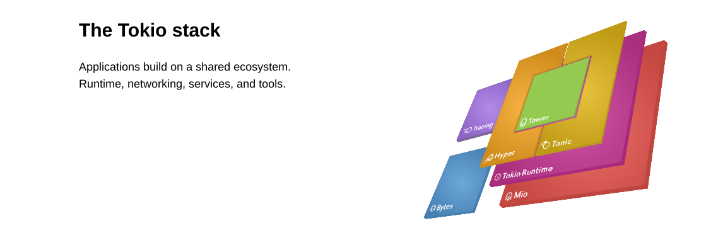
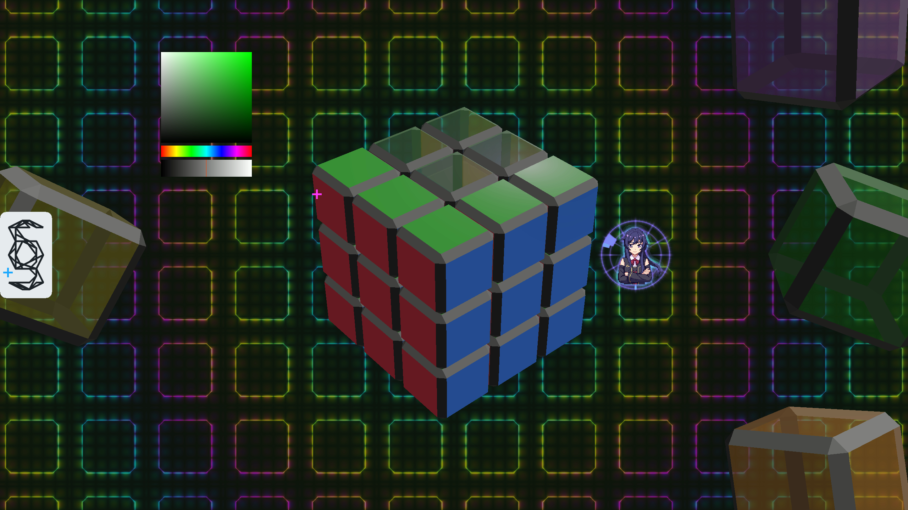

<p align="center"></p>

<h1 align="center">A RUST KERNEL WHERE CODEX RUNS NATIVE.</h1>
<h1 align="center">BUILD YOUR UNIVERSE ABOVE TOKIO.</h1>

<p align="center"><strong>TRUEOS · ONE ~19 MB BUNDLE · RUST KERNEL · CODEX ON THE DESKTOP</strong></p>
<p align="center"><em>No doubt something has changed.</em></p>
<p align="center"><a href="https://github.com/t4ce/TRUEOS/releases/latest"></a></p>
<p align="center"><a href="tools/trueos-boot/README.md">BOOT IT</a> · <a href="https://github.com/t4ce/TRUEOS-Blueprints">BUILD A BLUEPRINT</a></p>

TRUEOS is a Rust kernel with a native desktop, a browser, an editor, and an agent that works with all of them.
The agent is **Codex CLI**: OpenAI's official Rust CLI, compiled with `rustc` for TRUEOS and running natively on the machine.
Codex is an on-demand Blueprint, downloaded separately from the ~19 MB base bundle. Its current package is **about 80.5 MB**. Anyone can install it through AppDB, using the same catalog and package workflow as any other app; AppDB has no special distribution path for Codex.
Sign in with your Codex account; sign-in pages open in Hull. Your account's usage limits still apply.
**Meet Lilly**, the animated face of Spirit on your desktop. She shows when the agent is working or waiting for your next decision or prompt. Subagent indicators automatically use each agent's suggested name, so you can visually keep track of their states.

<p align="center"></p>

TRUEOS is a research and engineering tool for developers and hobbyists. Tech enthusiasts can get the most out of it: driver support is still small, but the tooling to wire that last mile, with AI or with both hands, is wide open in [tools/](tools/).

> [!WARNING]
> **This is an experimental release, not a production-ready or security-hardened platform.** Useful work is possible, but the firewall is not integrated and authentication, TPM integration, isolation, and recovery are still being developed. Do not use it for banking, sensitive accounts, or private data, and never keep the only copy of your work here.
>
> Use spare hardware and a controlled lab or test network, isolated from sensitive devices and services. A local LAN or DMZ alone does not make the system secure. Production readiness is a goal, with no fixed release date.
>
> This tool is built for constructive work. Please use it with care and for the benefit of others.

### Codex sign-in and workspace protection

Codex sign-in is available in the current build with a specific protection already active: TRUEOSFS access keys. When Codex's private workspace is first provisioned, TRUEOS creates a unique key and saves its ownership relation persistently. That key protects the workspace across launches, including Codex's internal session files.

Other apps and the builtin file browser do not gain access to that private workspace simply by being installed or open under another login. Access is tied to the authenticated owner and the launched app container, with explicit delegation for Codex's SQLite service. Codex can still work with permitted files outside its private workspace, and you can share project files with it without exposing its internal session storage.

This is an active filesystem boundary, while the broader account and permission-management interface is still unfinished. It provides a concrete safeguard for trying Codex sign-in, but it is not a guarantee that a session cannot be stolen: the kernel and trusted services remain part of the security boundary, and access keys do not encrypt the disk. Someone who can read the disk through another operating system may recover session data. Network security and the rest of the platform still need hardening; use a test account and a controlled setup accordingly.

The privilege to use AI will lead to new generations of algorithms.
While a lot of effort goes into the production of hardware, maintaining large data centers, energy, and bandwidth requires infrastructure for the power demand inherent to the raw computation of inference.
This enormous effort enables us to enjoy that privilege of intelligence, and that revolution leads to a Codex of 10 keypoints dedicated to AI.

> [!IMPORTANT]
> **QEMU and KVM work. The VirGL path is basic.** It is a small virgl wire encoder with a minimal UI4 composition: enough for a feel of the desktop with a shell. It is not recommended beyond basic checks, and it is not the experience to have fun with. What it misses is the roughly 100,000 lines of custom Intel driver in [src/intel](src/intel/), a significant part of the display engine. That leaves two choices:
>
> 1. **Accept TRUEOS as a bare-metal, primary hypervisor kernel.** This is the default and the real experience. Boot it on a supported Intel machine, as described below.
> 2. **Develop the hardware acceleration features in Rust yourself.**
>
> Both are legitimate. Advancing the VirGL encoder would be a quick, iterative job, but the author has already built the native Intel stack, so that path is open for anyone who wants it. Mesa and Vulkan are powerful stacks, and someone dedicated to figuring them out for QEMU is welcome: we take that.

## § PREFACE: KNOWLEDGE WE BUILD ON

Knowledge grows as people pass on what they have learned, and each generation adds to it. Software and language models are part of that continuing exchange, built from the work of people who wrote, tested, taught, and shared what they knew. TRUEOS builds on that work too.

### Where the operating system meets the application

At some point, the operating system ends and your application begins. The boundary between Rust's standard library and the platform beneath it is where TRUEOS connects familiar Rust code to its own services. TRUEOS has adapted Tokio's multithreaded runtime as a first-class userspace runtime, giving applications a familiar foundation for asynchronous tasks, I/O, timers, and synchronization.

<p align="center"><a href="https://tokio.rs/"></a><br><sub>Reference image: “The stack” from <a href="https://tokio.rs/">tokio.rs</a> · Nov 11, 2026, 19:12 CET.</sub></p>

If you already know the Tokio ecosystem, that experience carries over to native TRUEOS apps. Shared application logic can stay portable across platforms, while TRUEOS-specific integration uses `cfg(target_os = "trueos")` and the Blueprint APIs.

The [Blueprint workspace](https://github.com/t4ce/TRUEOS-Blueprints/blob/main/Cargo.toml) currently pins Tokio to `=1.54.1` and patches it to the TRUEOS-adapted implementation. The target selects the platform configuration; the version pin and workspace patch select the matching runtime. Build through the Blueprint workflow to bring those pieces together, then build your application on top.

## § STEPS OF GUIDANCE

These take precedence over anything else in this document:

- **A.** Security of all participants. This matters most.
- **B.** TRUEOS runs fine for the daily tasks it has to solve.
- **C.** It should be a fun experience.

Security is not a stage that comes after features, and a feature is not secure just because it exists. Hardware capabilities form the foundation: CPU randomness, a trusted platform module (TPM), and CPU virtualization such as Intel VT-x. They give us the means to design mathematically grounded security on top, but a secure foundation does not make the layers above it secure.

So we start with the feature, assuming the hardware capabilities are there, and then we make it secure. Making a feature secure mostly means that one or more users can use it, by telling the software what it may access on the filesystem and on the network layer. Hardware virtual machines can keep each app separate, using the same CPU capability.

**Achieved:** CPU randomness (RDRAND and RDSEED) and VT-x guests are in tree, Blueprints have a VT-x guest launch path, and an access-key model exists. **Next:** turn the access checks from warnings into enforcement, close the open hypervisor mitigations in [security.rs](src/hv/security.rs), and add a TPM backend for the machine key.

## THE CODEX OF 10 KEYPOINTS, DEDICATED TO AI

Each bar counts building blocks already in the code, not benchmarks. Keypoints 8–10 come from the platform vision below.

### § We minimize power consumption
`███░░░░░░░` **30%** · **Achieved:** idle cores halt by default and wake on work or timers ([power/mod.rs](src/power/mod.rs), [runtime.rs](src/runtime.rs)), and HWP and RAPL code is in tree ([hwp.rs](src/power/hwp.rs), [rapl.rs](src/power/rapl.rs)). **Observed on the i5-14500T rig:** 32–33°C across ten desktop snapshots; energy readings are still pending. An explicit package-only RAPL sampler is now in source ([measurement notes](tools/aiupsell/power/README.md)). **Next:** validate it on the rig and publish watts and joules per completed job.

### § Instant kernel updates with 0 downtime
`██████░░░░` **60%** · **Achieved:** RAM kernel replacement through 20 logged steps, with AP parking, PCI DMA containment, and handoff validation ([os_update.rs](src/shell3/os_update.rs), [live_update.rs](src/live_update.rs)). **Measured on the .94 hardware rig:** one LAN live update recovered Websys's Axum HTML and CSS within a **19.53 s observed downtime upper bound**, including SSH reconnect and the manual `§§websys` restart; 250 ms probes and warm-handoff steps 18–20 verified recovery ([measurement and evidence](docs/live-update-downtime-2026-11-06.json)). **Next:** measure recovery through the existing autostart path, then reduce the service pause toward zero downtime.

### § A code harness that effectively lets AI take over
`██████░░░░` **60%** · **Achieved:** Codex CLI runs natively with Spirit tools, and its sign-in opens in Hull ([codex-hull-integration](docs/codex-hull-integration-2026-11-03.json)). **Next:** Codex plugins return once their catalog path is hardened against fragmented RAM ([codex-plugin-disable](docs/codex-plugin-disable-2026-11-03.json)).

### § Revolutionary human-machine interaction
`█████░░░░░` **50%** · **Achieved:** the native desktop runs Codex, Edit, Cubes, and Hull on real displays. Lilly shows running, waiting, and review states and moves through the mediated cursor path ([lilly_protocol.rs](src/spirit/lilly_protocol.rs), [lilly_cursor.rs](src/spirit/lilly_cursor.rs)). **Next:** voice in everyday use (TTSTT/Kokoro is an optional build today).

### § Tools and documentation to autonomously enable robotics
`█░░░░░░░░░` **10%** · **Achieved:** a [flight controller simulator](https://github.com/t4ce/TRUEOS-Blueprints/tree/main/apps/flight_controller_sim) Blueprint: `no_std` attitude control with motor outputs, a robotics seed in the catalog. **Next:** a robotics toolkit and docs on top of the Blueprint SDK.

### § Driver revolution, hardware compatibility on the fly
`███░░░░░░░` **30%** · **Achieved:** a native Gen12 GPU driver; xHCI USB with HID, storage, and CDC-ECM classes; six wired and virtio NIC drivers; three Intel Wi-Fi drivers; and runtime xHCI backend selection with a heal path ([intel](src/intel/), [usb3](src/usb3/), [net](src/net/)). **Next:** AI-reasoned synthesis of the drivers the tree doesn't have yet.

### § Interaction of multiple humans and AIs in harmony, concurrently
`███░░░░░░░` **30%** · **Achieved:** Shell3 sessions and retained Matrix slots, with Blueprints hosted in VMX lanes ([hv](src/hv/)). **Next:** multi-user identity and the Y-Space hive.

### § One ~19 MB bundle, batteries included
`████████░░` **80%** · **Achieved:** the local build's native archive is 25.2 MB and holds the stripped kernel (builtin apps and GPU kernels compiled in), the EFI loader, and the GuC firmware ([boot guide](tools/trueos-boot/README.md)). USB storage, HID, and network-class drivers are in tree. **Next:** publish the released archive size with every version.

### § One compatible CPU and one network device
`████░░░░░░` **40%** · **Achieved:** Intel x86-64 with UEFI, a Gen12 GPU path vertically validated on Alder Lake-S GT1 (8086:4680, rev 0C), and Raptor Lake-S UHD 770 (8086:A780) validated for its forward render path. A network device needs only PCI, or USB on top of PCI for a USB NIC, as the RTL8153 with CDC-ECM shows ([usb3/net.rs](src/usb3/net.rs)). **Next:** widen the admitted CPU list, one validation pass per SKU.

### § Codex Rust CLI that patches its own way to the user
`███░░░░░░░` **30%** · **Achieved:** the Codex Rust CLI (`codex-rs/cli`) is compiled for TRUEOS and listed in the [Blueprint catalog](https://github.com/t4ce/TRUEOS-Blueprints/blob/main/apps.json), and it works in the Edit workspace over a tested IDE transport. **Next:** a demonstrated self-patch of a running node.

The average across the ten is about 40%. The foundations are in place; the next blocks are measurement, hardware breadth, and autonomy.

## THE NATIVE INTEL XE-LP GPU STACK

<p align="center"><strong>Bare metal. No Linux, Mesa, or DRM underneath. Modern Intel graphics, written in-tree in Rust.</strong></p>

The GPU driver is the largest directory under `src/`: about 100,000 lines of Rust in [src/intel](src/intel/). Its manifests have no DRM or Mesa dependency.

- **Display:** the native panel path drives the desktop on real hardware ([tgl_native_panel.rs](src/intel/tgl_native_panel.rs), [display](src/intel/display/)). The screenshots below are captures from real hardware.
- **Render:** a 3D pipeline with logical ring contexts, URB setup, and Hi-Z ([render](src/intel/render/)). The vgpu API that Maxpix draws through lands on this path ([vgpu.rs](src/gpu/vgpu.rs)).
- **Compute:** GPGPU operations on the render command streamer ([gpgpu](src/intel/gpgpu/)), with an experimental compute API for Blueprints ([native_compute_api.rs](src/ui4/blueprint_ui4/native_compute_api.rs)).
- **Firmware and scheduling:** Intel's GuC firmware, driven through the CTB transport, with BCS0 blitter copies ([guc_ctb.rs](src/intel/guc_ctb.rs), [blt.rs](src/intel/copy/blt.rs)).
- **Memory:** Gen12 PPGTT page tables ([ppgtt.rs](src/intel/ppgtt.rs)).
- **Media:** VDBOX decode on Alder Lake-S ([media](src/intel/media/)), and a resident service that streams the desktop as H.264 from the Gen12 encoder over UDP, with no CPU frame copy ([h264_encode_stream.rs](src/ui4/h264_encode_stream.rs)).

**Validated silicon.** The vertically validated path is Alder Lake-S GT1 (8086:4680, rev 0C), from device claim through render admission and generated kernel artifacts ([pci/mod.rs](src/pci/mod.rs)). The in-tree validation notes record sustained concurrent 3D scenes and GPGPU work on distinct GuC contexts, with zero context loss or memory faults. Raptor Lake-S UHD 770 (8086:A780) is physically validated for the Churn forward path ([render/constants.rs](src/intel/render/constants.rs)).

**What that unlocks**

- **One native path for pixels and compute:** Maxpix draws through the vgpu API, UI4 can host GPGPU-generated surfaces, and Shadertoy picks its kernels from an immutable catalog. None of it runs on Linux, Mesa, or DRM.
- **Hardware screen streaming:** the display feed goes into the Gen12 encoder and out over UDP, with no CPU frame copy or software codec in between.
- **A pattern for the AI last mile:** firmware, submission, display, and validation on real silicon form one reusable shape for the smaller drivers still to come.
- **Mainstream targets:** Alder Lake-S and Raptor Lake-S are mainstream Intel desktop graphics, and public native stacks for them are rare.
- **Rare by the numbers:** outside Linux and Intel's own drivers, the only native Xe-LP effort our search found is [Redox OS](https://www.phoronix.com/news/Redox-OS-Own-Intel-GPU-Driver): display-only mode-setting for Kaby Lake and Tiger Lake, reported in January 2026, with no acceleration.

**What is Intel's, and what is ours.** The driver is in-tree Rust. The GPU kernels are baked offline with Intel's compiler (OCLOC or IGC) from [trueos-shader](crates/trueos-shader/) and compiled into the kernel. The GuC firmware is Intel's unmodified blob from linux-firmware, shipped in the archive ([firmware/i915](firmware/i915/)).

## A PLATFORM FOR NODES ACROSS THE WORLD

TRUEOS aims to be the platform to deploy a large number of nodes across the world. Modern CPUs offer integrated graphics and rich computation, and that is what we support.

The operating system should be program code that is for everybody. Parts like the USB stack are batteries included. A specific missing driver will be reasoned out of thin air. The AI does the final last-mile wiring, by nature. A vendor can't support arbitrary platforms. Supporting a platform is the platform's job, and for systems engineers it has always been the largest share of the work: firmware, power, interrupts, drivers, and devices have to work in harmony as one large, coherent system. That work is enormous, so we offload some of it here.

Our goal is a versatile bundle of what an operating system is expected to ship to a node, not a generic cross-platform build. The current bundle is approximately 19 MB.

The single condition is a compatible CPU and a network device. That needs just PCI, or USB on top of PCI for a USB NIC. With just that, the operating system should offer Codex Rust CLI integration that can literally patch its own way to the user.

*Achieved: the bundle and the USB NIC path (keypoints 8 and 9). Next: AI-reasoned drivers and self-patching (keypoints 6 and 10).*

## REASONING IS USERSPACE. THE KERNEL KEEPS THE LIGHTS ON.

Reasoning comes from Codex CLI, the harness that runs natively on TRUEOS, through your Codex account. Your account's usage limits still apply.
Local models run as userspace Blueprints. [apps/lumen](https://github.com/t4ce/TRUEOS-Blueprints/tree/main/apps/lumen) is the starting template, so anyone can build a local model app on the platform.

Idle cores halt, and work wakes them. Token maxing is the mood. Useful work per watt is the goal.

*Please remain calm. Ideally, the processors already are.*

## WORK IN HARMONY: ASYNC PARTS, ONE SMOOTH MACHINE

The cores, the GPU and its encoder, and the network card each run on their own timing. The craft is in making them work in harmony, so throughput stays balanced and the parts keep each other fed. That takes *hard effort and a lot of craftsmanship*. We start with a concept that runs slowly, work out the nuts and bolts, and only then scale it up. A careful eye stays on the watts: the RAPL readout is already in tree, and measured numbers come next. Every result is held to a direct side-by-side comparison, like the ones below.

It is important to be mindful of a person's craft. A craftsperson always prepares the next iteration through their actions, so it can be equally or better prepared. That is a routine of sorts: clean the tools and put them back in place after the job is done for the day, so the workshop feels pleasant when the sun rises again.

All of that effort aims at one thing: a machine that almost looks like one big, synchronously running, never-stuttering electric field of glory.

## THE DESKTOP, NOT THE SLIDE DECK.

<p align="center"></p>
<p align="center"><sub>Cubes on native TRUEOS. Fullscreen still; the animations below are cut from the node's own recordings.</sub></p>

<table>
  <tr>
    <td width="50%" align="center"></td>
    <td width="50%" align="center"></td>
  </tr>
</table>

<p align="center"></p>
<p align="center"><sub>Codex, Edit, and Lilly on the desktop: a running session, not a mockup.</sub></p>

<table>
  <tr>
    <td width="50%" align="center"></td>
    <td width="50%" align="center"></td>
  </tr>
  <tr>
    <td width="50%" align="center"></td>
    <td width="50%" align="center"></td>
  </tr>
</table>

<p align="center"><sub>One recording from the node, cut into four clips of four 3-second sections each.</sub></p>

## HULL: CONCEPT VS. REAL

<table>
  <tr>
    <td width="46%" valign="top"></td>
    <td width="8%" align="center" valign="middle"><h3 align="center">VS</h3></td>
    <td width="46%" valign="top"></td>
  </tr>
  <tr>
    <td align="center"><sub><strong>CONCEPT</strong> · AI-generated illustration, made with Codex on Ubuntu Linux</sub></td>
    <td></td>
    <td align="center"><sub><strong>REAL</strong> · the concept rebuilt as HTML/CSS, rendered natively in Hull on TRUEOS · <a href="tools/aiupsell/page/index.html">Page source</a> · <a href="tools/aiupsell/page/README.md">Open it yourself</a></sub></td>
  </tr>
</table>

Hull is a builtin Blueprint: HTML/CSS rendering, JavaScript through QuickJS, downloads, and local project previews.
Codex's sign-in and browser actions open here. Web compatibility keeps growing.

## EDIT: A PROJECT WORKSPACE THAT TALKS TO CODEX.

Edit is a builtin Blueprint, adapted from [Microsoft Edit](https://github.com/microsoft/edit) to TRUEOS projects.
Codex connects to the workspace, so the agent works on the source beside you while Lilly stays alongside.
This is independent TRUEOS work, with no Microsoft or OpenAI endorsement implied.

*The future may be inevitable. Your idle power bill shouldn't be.*

## TEN BLUEPRINTS, USERSPACE FIRST

Apps are userspace Blueprints. Builtins ship inside the kernel bundle; the rest come from the Blueprint catalog. Availability depends on your release and catalog.

| # | Blueprint | Source | Why open it? |
| --- | --- | --- | --- |
| 1 | [Hull](https://github.com/t4ce/TRUEOS-Buildins/tree/master/hull) | Builtin | Browse, research, download, and preview a local HTML project. |
| 2 | [Edit](https://github.com/t4ce/TRUEOS-Buildins/tree/master/edit) | Builtin | A native project workspace that Codex can work in. |
| 3 | [Codex](https://github.com/t4ce/codex) | Catalog (`codex-cli`) | OpenAI's Codex CLI, compiled from `codex-rs` with `rustc`. Sign in and describe the task. |
| 4 | [Cubes](https://github.com/t4ce/Cubes) | Catalog | Fullscreen cubes, worlds, and native rendering experiments. |
| 5 | [Maxpix](https://github.com/t4ce/TRUEOS-Blueprints/tree/main/apps/maxpix) | Catalog | 230,400 particles: tornadoes, knots, and quantum-weighted scenes. |
| 6 | [Shadertoy](https://github.com/t4ce/TRUEOS-Blueprints/tree/main/apps/shadertoy) | Catalog | Native shader visuals on the Intel GPU. |
| 7 | [Player](https://github.com/t4ce/TRUEOS-Blueprints/tree/main/apps/Player) | Catalog | Media and audio playback. |
| 8 | [OSM](https://github.com/t4ce/TRUEOS-Blueprints/tree/main/apps/osm) + [Frog](https://github.com/t4ce/TRUEOS-Blueprints/tree/main/apps/Frog) | Catalog | OpenStreetMap on a desktop you can extend. Right-click a point on the map and Frog shows its live weather. |
| 9 | [Termdir](https://github.com/t4ce/TRUEOS-Buildins/tree/master/termdir) | Builtin | Browse TRUEOSFS as a graph, with a minimap, SHA-256, and archive actions. |
| 10 | [PrismQ](https://github.com/t4ce/TRUEOS-Blueprints/tree/main/apps/prismq) | Catalog | Quantum circuits. Maxpix's quantum scenes build on them. |

## SYSTEM CAPABILITIES

The app catalog sits on top of services and tools already available in TRUEOS:

| Capability | Current scope |
| --- | --- |
| Video playback | Up to a 4K soft cap; practical limits depend on the CPU, Intel iGPU, and display engine. |
| Capture | Record video, audio, or both. Camera support is planned. |
| Hardware discovery | Generic PCI enumeration and a USB stack provide the foundation for device support. |
| Networking | PCI network drivers, Intel Wi-Fi (`iwl_ax201`, `iwl_ax211`, and `iwl4965`), and USB Ethernet through CDC-ECM (RTL8153). Coverage and features are still evolving toward broader, more generic support. |
| System information | Inspect BIOS and system tables. |
| System logs | Select and filter detailed logs while the system is running. |
| Resource monitoring | Monitor RAM usage and CPU cores. |
| Hypervisor | The foundations are in place for every launched Blueprint. The full lifecycle, including pause and replication, is still unfinished. |
| Disk management | Inspect and manage disks, and format them with the custom TRUEOSFS filesystem. |
| Authentication | Cryptographic and two-factor authentication foundations are present. Full TPM integration is unfinished. |

## BOOT IT. TRY IT.

<p align="center"></p>

1. Download the [latest release](https://github.com/t4ce/TRUEOS/releases/latest) and check the SHA-256 in its notes.
2. Unpack the native archive onto a FAT-formatted UEFI boot partition, following the [boot guide](tools/trueos-boot/README.md). It holds exactly `TRUEOS.elf`, `EFI/BOOT/BOOTX64.EFI`, and `EFI/BOOT/tgl_guc_70.bin`. Keep your previous boot files for recovery.
3. Boot a supported Intel machine from the UEFI boot menu.
4. Install Codex from AppDB, open Hull or Edit, launch Codex, sign in, and give the agent a concrete task.

**Achieved today**

- **CPU:** Intel x86-64 with UEFI boot.
- **GPU:** native Intel Gen12 Xe-LP, with display, render, compute, media, and blitter paths. Vertically validated on Alder Lake-S GT1 (8086:4680, rev 0C), and Raptor Lake-S UHD 770 (8086:A780) is validated for its forward render path. See [the GPU stack](#the-native-intel-xe-lp-gpu-stack).
- **Network:** one NIC is enough: Intel e1000 and i226, Realtek r8169, r8125, and r8139, virtio-net, Intel Wi-Fi AX201, AX211, and 4965, and USB Ethernet with CDC-ECM (RTL8153).
- **Desktop and agent:** the UI4 desktop runs Codex, Edit, Hull, Cubes, and Lilly.
- **Blueprints:** builtins ship in the kernel bundle, and the catalog covers the rest.

**Next building blocks**

- Widen the admitted Intel list. Tiger Lake bring-up is in progress as an experiment.
- Harden recovery and isolation for the experimental build.
- Bring Codex plugins back once their catalog path is hardened.
- Measure live-update service recovery through autostart and reduce the observed pause.
- Grow Hull's web compatibility.
- Ship Lumen as a userspace model Blueprint.
- Build the robotics tooling and AI-reasoned drivers: the vision blocks.

**Build it yourself**

```sh
bash tools/trueos-boot/prepare.sh --release
```

You need the sibling [TRUEOS-Buildins](https://github.com/t4ce/TRUEOS-Buildins) and [TRUEOS-Blueprints](https://github.com/t4ce/TRUEOS-Blueprints) checkouts and the pinned [nightly-2026-07-10 toolchain](https://github.com/t4ce/TRUEOS-Rust-Toolchain-nightly-2026-07-10).

## THE INTERIOR IS MISSING

The bare-metal boot is the default experience, and the real one. It is a framework that lets people fill in the parts where it is no longer about the architect. The architecture is in the repo. The interior is still missing, *psst… it's missing ;)*

Interior builders, this part is yours. Find something you always wanted to try, and TRUEOS may make it easier than you expect. Start with the [Blueprint catalog](https://github.com/t4ce/TRUEOS-Blueprints) or the [Builtins](https://github.com/t4ce/TRUEOS-Buildins).

<details>
<summary><strong>FOR THE PEOPLE WHO WANT TO READ THE KERNEL</strong></summary>

- Scheduling: per-CPU executors, a Tokio worker pool for Blueprint apps, and explicit blocking lanes for synchronous code ([threads.rs](src/r/threads.rs), [blocking.rs](src/r/blocking.rs)).
- Idle: cores run `sti; hlt`, with a TSC-deadline timer armed when a wake time is known. Remote work wakes them ([runtime.rs](src/runtime.rs), [remote_work_wake.rs](src/remote_work_wake.rs)).
- Codex: `codex-rs/cli` from [t4ce/codex](https://github.com/t4ce/codex), compiled with `rustc` for TRUEOS and listed as `codex-cli` in the [Blueprint catalog](https://github.com/t4ce/TRUEOS-Blueprints/blob/main/apps.json).
- [Kernel and platform source](src/) and the [native executor](crates/trueos-executor/README.md)
- [Runtime inventory](tools/docs/runtime-inventory.md) and [runtime retirement decisions](tools/docs/runtime-retirement.md)
- [Builtins](https://github.com/t4ce/TRUEOS-Buildins) and [Blueprint catalog and SDK](https://github.com/t4ce/TRUEOS-Blueprints)
- [Screenshots, demo sources, and capture notes](tools/aiupsell/)

</details>

TRUEOS is **source-available**. Official unmodified binaries may be used under the project license;
source modification and redistribution require the permissions described there.
Independent Blueprint authors retain their own rights subject to their dependencies.
See the [license](lic/TrueOS.LICENSE), [notice](lic/NOTICE), and [third-party notices](lic/THIRD_PARTY_NOTICES.md).

<iframe src="https://github.com/sponsors/t4ce/card" title="Sponsor t4ce" height="225" width="600" style="border: 0;"></iframe>
