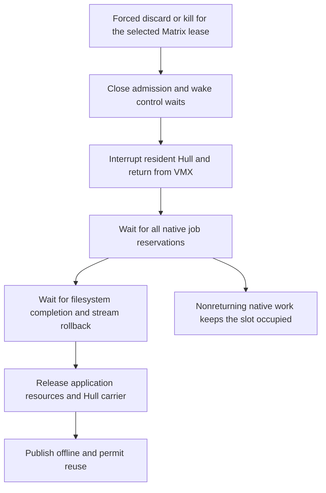

# VMX slot recovery audit — 2026-10-23

This records the implementation before the recovery changes. The current
contract and rig-only verification procedure are in
[VMX execution lifecycle](vmx_lifecycle.md).

The missing recovery mechanism is forcible retirement of VM-owned **host-native
execution**. TRUEOS already has a generation-tagged interrupt for a resident
Hull, and kill already cancels suspended std/Tokio continuations. Neither
mechanism can take control back from an arbitrary native closure or thread
that never returns or yields. Broadcasting another fixed IPI does not close
that gap.

This is a source audit of the current working tree. No kernel recovery change,
deployment, rig access, or hardware hang reproduction was performed. Findings
below establish possible permanent-stop paths, not which path caused a
particular recent hang.

## Where the slot stays owned

Registered cooperative stop retains admission for guest cleanup, with a
two-second deadline before escalation to `force_stop`. That deadline does not
bound native draining. `force_stop` closes admission,
requests BSP filesystem rollback, wakes native control wakers and Hull waits,
and sends the lifecycle kick
([hv/mod.rs](../../src/hv/mod.rs#L2446)).

After the Hull returns, its task awaits `drain_guest_jobs`. This deliberately
loops until `in_flight == 0`, retaining executable pages, heap and process
resources indefinitely and reporting every five seconds
([lifetime.rs](../../src/r/blocking/lifetime.rs#L195),
[teardown caller](../../src/hv/mod.rs#L4206)).

The filesystem wait follows that drain. Pending broker operations, abandoned
streamed writes and async filesystem requests must also retire before the
carrier is released and offline is published
([filesystem gate](../../src/hv/mod.rs#L4224),
[offline publication](../../src/hv/mod.rs#L4471)). A native-job count of zero
therefore does not, by itself, prove that a stuck slot can be released.

## What the interrupt infrastructure already does

| Mechanism | Current behavior | Recovery limit |
| --- | --- | --- |
| Remote wake, vector `0x41` | Wakes an AP for executor work | Does not preempt an active poll |
| Lifecycle kick, vector `0x42` | Publishes VMID, run generation, action and sequence to the Hull owner's CPU | Handler records delivery and EOIs; no task scan or destruction |
| VMX preemption timer | Requests a 125 ms quantum when supported | Applies while executing in VMX non-root, not native host execution |
| Native control wakers | Make suspended VM continuations runnable on kill | Carrier must return to its executor to process them |

See [remote_work_wake.rs](../../src/remote_work_wake.rs#L87),
[control_kick.rs](../../src/hv/control_kick.rs#L164),
[VM-exit generation validation](../../src/hv/mod.rs#L544),
[timer setting](../../src/allcaps.rs#L132), and
[native control wakers](../../src/r/threads.rs#L38).

The lifecycle sender does not require the caller to be the BSP. It rejects a
**target** of BSP slot zero. A request from another live shell/AP can already
reach the Hull owner, provided the control operation validates the selected
Matrix lease. The missing behavior is recovery across the native carriers.

AP executor polling can run with host interrupts disabled. The runtime calls
`cli` before its idle decision, and `sti; hlt` is followed by `cli`; the next
executor pass does not unconditionally enable interrupts
([runtime.rs](../../src/runtime.rs#L53)). A native spinner in that state can
leave a fixed IPI pending. This differs from a resident VM: with
external-interrupt exiting enabled, guest IF does not prevent VM-exit.
Intel documents the distinctions in [SDM volume 3A, section 7.8.1](https://cdrdv2-public.intel.com/835754/253668-sdm-vol-3a.pdf)
and [VMX external-interrupt exiting, section 27.4.1](https://cdrdv2-public.intel.com/858441/252046-080-sdm-change-document.pdf).

No NMI handler is installed in the current IDT construction
([exceptions.rs](../../src/exceptions.rs#L15)). An NMI observation path would
need to be installed before using NMI escalation. Returning normally from
such a handler would still resume the interrupted native code.

## The execution cases need different treatment

**Suspended std/Tokio workers:** pthread spawning reaches `r::threads::spawn`.
Each `ThreadTask` owns a pinned stack and carries VM identity. Forced kill is
checked before its normal wait is polled or guest execution is resumed.
It returns `Ready` and discards the suspended guest frames without invoking
guest destructors. Registration precedes the kill-flag read, covering the
ordinary lost-wakeup race
([pthread route](../../src/std_abi_shim.rs#L7595),
[control boundary](../../src/r/threads.rs#L285),
[waker registration](../../src/r/threads.rs#L327)).

**Running std/Tokio workers:** `ThreadTask::poll` synchronously switches to the
child stack. Only after that switch returns does it restore CR3, current-thread
state, WLS, allocation context and kernel task domain. No asynchronous escape
back to that restoration sequence exists
([threads.rs](../../src/r/threads.rs#L371)). The existing test
`external_notification_does_not_preempt_a_running_continuation` explicitly
models this limit; it injects a host notification, not a hardware interrupt
([test](../../src/r/threads/tests.rs#L300)).

**Finite service-lane closures:** a persistent host service task dequeues work
for multiple VMs and directly invokes each closure on its own call stack,
under guest allocation/domain guards. Removing that shared executor task would
also abandon host worker state and guard restoration. It is not a disposable
per-VM task
([blocking.rs](../../src/r/blocking.rs#L183),
[service loop](../../src/r/blocking.rs#L237)).

**Queued closures behind a stuck worker:** queued entries have a VM tag and a
job reservation. Kill currently skips them when the worker dequeues them; no
independent per-VM queue purge exists. A stuck earlier closure can therefore
strand later killed-VM entries too
([entry ownership](../../src/r/blocking.rs#L80),
[skip on dequeue](../../src/r/blocking.rs#L146)).

**Retained reservations without a task:** failure to install a guest allocation
realm deliberately forgets both the pending closure and its owner token. The
diagnostic phase becomes `realm-unavailable`. The service task can continue,
but no ordinary owner remains to release that reservation. Scanning executor
tasks cannot recover it
([blocking.rs](../../src/r/blocking.rs#L193)).

## Why an ISR cannot simply drop every matching task

The raw executor has no VMID/run-generation field, cancellation protocol or
erased future destructor. Its normal destruction path follows `Poll::Ready`.
Sleeping tasks are not all represented in the ready queue; a ready batch can
also already be detached onto the active executor stack
([TaskHeader](../../crates/trueos-executor/src/raw/mod.rs#L108),
[future completion](../../crates/trueos-executor/src/raw/mod.rs#L275),
[run queue](../../crates/trueos-executor/src/raw/run_queue.rs#L104)). The separate
`Realm` API provides scheduling budgets and counts, not VM-owned cancellation;
no runtime `src` users were found in this audit.

An interrupted poll can have live mutable references and host locks. Its
per-CPU VM allocation/domain tag is not evidence that it is outside a host
critical section. Destruction from that interrupt would bypass the existing
restoration boundary. TRUEOS's live-update rendezvous already treats host
stack interruption as unsafe and parks at executor boundaries
([live_update.rs](../../src/live_update.rs#L429)).

Collective quiescence also matters for native stacks. Scoped guest threads can
borrow another thread's stack. Currently kill completes each `ThreadTask`
individually, and its stack mapping drops immediately; whole-VM native draining
only gates later VM cleanup. No barrier retaining those individual stacks
until all native peers stop was found
([stack contract](../../src/r/threads/stack.rs#L1),
[stack drop](../../src/r/threads/stack.rs#L161)). This is an additional safety
concern for recovery design, not an established cause of the reported hang.

The existing panic AP restart is not a VM recovery primitive: it constructs a
new PerCpu/executor without retiring old tasks, VM identities, admission
reservations, carrier leases or wakeups. It also does not establish a fresh
VMX lifetime when that CPU is already marked active
([cpu.rs](../../src/cpu.rs#L290),
[VMX initialization](../../src/hv/mod.rs#L430)). Reusing it would leave the
ownership problem unresolved.

### Follow-up: captured AP restart and subsequent stall

The local capture `bld/baremetal-logs/trueos-baremetal.2.log` contains an
allocation-failure panic at line 18264, restart of AP slot 19/LAPIC 62 at line
18276, and `atomic_bomb post-restart work ... restart_count=1` at line 18289.
The replacement executor therefore did execute work. Subsequent progress
samples show its poll counters stop advancing.

The current source strongly explains that later stall: `IN_HANDLER` is one
global counter, incremented on handler entry and never cleared. Any subsequent
panic, even on another CPU, enters `cli`/`hlt` before logging or restarting
([exceptions.rs](../../src/exceptions.rs#L78)). The replacement executor's test
task deliberately panics again after two seconds plus one second
([cpu.rs](../../src/cpu.rs#L262)). The frozen capture matches this second-panic
guard; it does not directly record the second panic's instruction pointer.

Rust permits a custom `no_std` panic handler to transfer into another
never-returning kernel loop. TRUEOS's `panic=abort` configuration supplies no
automatic stack unwinding or guard cleanup. This makes restart recovery an
explicit kernel responsibility; it does not prevent the first restart from
executing. The ordinary exception handlers for faults such as page faults
halt directly and do not take the Rust-panic restart branch.

## Proposed recovery contract

1. **Request recovery from any live control session.** Validate the Matrix
   lease and capture `(VMID, run_generation, recovery_sequence)` under lifecycle
   control. Close admission before enumerating carriers. Keep requests sticky
   until each relevant carrier acknowledges them; a new incarnation must
   reject every stale request. Handle an origin that is itself a target without
   waiting synchronously for its own retirement.
2. **Retire queued and suspended work through host-owned records.** Purge
   matching service queue entries independently of worker progress, matching
   their reservation generation. Skip guest payload destruction on forced
   discard, as the current dequeue kill path does, while retiring the host
   reservation and lane lease. Keep existing control-waker cancellation for
   suspended continuations. Retain abandoned stack backing until the VM's
   native peers have collectively stopped. A leaked `realm-unavailable`
   reservation needs an explicit recoverable retained record and proof that
   its payload is not running, rather than a fabricated decrement.
3. **Use interrupts for requests and bounded observations.** Maintain a
   registry of VM-owned work and relevant CPU carriers above the shared raw
   executor. Every AP can support the handler; request all online carriers if
   necessary, but retire only the exact incarnation. Keep ISR work to bounded
   atomic publication/capture. Report requested, observed, quiescent and
   retired states separately. IPI delivery is not a retirement acknowledgement.
4. **Add a separate contract for running native work.** A restricted NMI path
   could observe an IF=0 spinner. To escape it requires an audited return to a
   retained carrier boundary, restored CR3/TLS/WLS/allocation/domain state,
   explicit exclusion of host critical sections, and no concurrent future
   destruction. Move directly invoked service closures onto independently
   owned continuation stacks before promising this behavior for them. NMI
   delivery alone supplies none of these guarantees.
5. **Release through the normal teardown only after proof of quiescence.** All
   native peers must stop, reservations retire, filesystem work finish or roll
   back, and GPU storage quarantine remain honored. A timeout may report a
   blocked recovery, not make those resources reusable. If native execution is
   stuck while holding a host lock, guaranteed per-VM asynchronous destruction
   requires stronger isolation of that work; the current shared native model
   cannot promise it.

This supports a staged implementation: expose the blockers and recover queued
or parked work first; add running-native escape only with the separate audited
execution contract. It does not promise that every host-native hang becomes
recoverable without reboot.

## Diagnostics and validation

`shutdown_diagnostic_lines` already identifies teardown stage, force state,
native count, generation, carrier, phase and progress boundaries. Stop/kill
emit the full shutdown header and roster; pending native drain repeats its
count and roster every five seconds. Shell3 Hypervisor status currently
shows only the simple VM phase, so exposing these existing records there is a
useful first change
([diagnostics](../../src/hv/mod.rs#L1873),
[Shell3 status](../../src/shell3/service.rs#L887)).

The older [Cubes restore/stop incident](UI4_RESTORE_INCIDENT_20260909.md)
records the same shape: Hull exit, one retained native job, live shell/audio/net,
and repeated stop attempts. That incident required cooperative worker
cancellation; it does not establish the cause of a newer Tokio hang.

Checks run for this audit:

- `python3 tools/testpy/test_vmx_lifecycle.py`: **16 passed**.
- `python3 tools/testpy/test_native_worker_lifetime.py`: **11 passed**.
- `python3 tools/testpy/test_thread_scheduler.py`: **does not compile** on the
  current tree. Errors include missing `Stack::new`,
  `wls_blueprint_thread_slot`, `CompletionCell::poll_take` and
  `wake_killed_guest`. This harness therefore supplies no passing evidence for
  current scheduler cancellation. Production behavior above was inspected in
  source; the negative test was read, not successfully executed.

Recovery acceptance should additionally cover native spinners, IF=0, another
VM remaining live on the same carrier, queued work behind a stuck worker,
scoped stack borrows, stale requests after VMID reuse, self-targeting requests,
realm-install failure, streamed writes, and GPU quarantine. Host tests cannot
establish hardware interrupt-to-recovery correctness; that needs an isolated
VMX-capable test run.
