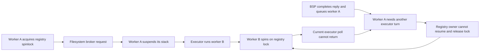

# Codex QEMU debugger evidence — 2026-10-14

Follow-up: [filesystem wait-boundary fixes and verification](codex-file-wait-fix-2026-10-14.md)
records the subsequent registry correction, a second observed fsync deadlock,
and the remaining response-transport failure. The report below preserves the
original diagnostic run.

## Finding

The current single-AP experiment reproduces a deadlock in the POSIX file shim.
One Tokio worker suspends for filesystem I/O while retaining the process-wide
regular-file registry spinlock. Another worker on AP19 spins on that lock.
The owner is queued to resume, but the spinning worker never returns to the
executor. Its filesystem result has already arrived.

This is a directly observed QEMU failure, strongly consistent with the earlier
physical probe pattern. The physical machine's instruction pointer and lock
owner have not been captured, so identical physical causation remains an
inference. No runtime source or placement changes were made for this run.

## Reproduction and artifact identity

Evidence directory: `bld/codex-debugger/20261014-141846/`.

- Booted the existing ISO with KVM/nested VMX, 20 CPUs, 8000 MiB RAM,
  loopback SSH port 22295, HTTP 18095, and GDB 12395. `run.json` records the
  launch and hashes. The disk uses QEMU `-snapshot`.
- The unused NVMe disk had no filesystem. Appstore initially timed out on
  filesystem readiness. Created a 512 MiB RAM disk through Shell3's `disc`
  administration UI, then used the normal `§§codex` Appstore path.
- The first launch, without credentials, reached onboarding at 4580 ms.
  Its AP continued dispatching. It was subsequently stopped.
- Copied the existing local auth file to the VM's temporary
  `apps/codex/.codex/auth.json`, then launched again. No fresh login code was
  required to reproduce the stall. This does not prove successful remote
  account validation: startup never reached account-status completion.
- The second launch flushed its first frame at 377 ms, finished state DB
  initialization at 983 ms, and entered app-server initialization at 994 ms.
  It then stalled without an app-server completion marker.
- The catalog's Codex digest matches local `dist/codex.bp`:
  `9a44ad1580ef62e1c08f90594b750a68137bf2cdebb207730aecff373f2a4d31`.
  Appstore uses digest verification. Both physical and emulator loader records
  show the same image size `0x7411D00` and entry offset `0x1B8A20`; this alone
  is not a physical package byte attestation.
- Stripping `TRUEOS.full.elf` produces exactly the booted `TRUEOS.elf`, digest
  `01dce6376ae1c2b321b0188611216f101e553767edcf57ef6a75e3d0b4ca3548`.
  There is no kernel address slide in these captures.

`freeze-evidence.log` is a fixed copy of the running serial capture.
`evidence-manifest.json` hashes that log, boot artifacts and debugger captures.

## Active contender: an ordinary C ABI open

`freeze-01.txt`, `freeze-02.txt` and `freeze-types.txt` capture the same AP19
at `RIP=0xffffffff804f7612`, `open+450`, with live `EFLAGS=0x2` (IF clear).
The instruction repeatedly reads lock byte `0xffffffff854c0a38`, which is 1.
DWARF identifies the lock as the VM0 process state's
`SpinMutex<RegularFileWorldRegistry>`.

The resolved stack is:

```text
spin::SpinMutex<RegularFileWorldRegistry>::lock
ProcessRegularFileWorlds::lock
open_regular_file_world                 src/std_abi_shim.rs:2375
open                                   src/std_abi_shim.rs:5038
std::sys::pal::unix::cvt_r<File::open_c>  module offset 0x1783e02
```

`freeze-pool-types.txt` resolves the contender's path as
`/etc/codex/requirements.toml`. A missing optional file is normal; the bug is
the lock/wait interaction, not this path's absence.

The associated native thread is `id=2147483651`, VM0 generation 4,
`tokio-rt-worker`. Its progress sequence remains 354436 at `guest-enter`.
The AP's poll counters remain `8592040/8592039`; ready tasks rise to five.
The fixed log contains samples through a worker stage age of 235091 ms.

## Parked owner and completed reply

`parked-threads.txt` walks the saved stack of worker `id=2147483650`, also on
AP19, using the actual context-swap layout from `src/r/threads/context.rs`:

```text
r::threads::suspend
r::threads::wait
fs::request_broker::submit<usize, read_file_len closure>
fs_read_file_len_host
trueos_kernel_sync_fs_read_file
std_abi_shim::read_file_from_cabi
open + 777
```

Source at `open_regular_file_world` acquires the registry guard before calling
`read_file_from_cabi` and uses that guard after both the read and metadata
request. The captured `open+777` return site lies on that read call. The guard
therefore remains alive on the parked stack. The spinlock has no owner field;
ownership is established from the saved call path and guard lifetime, rather
than from an owner-ID field in the lock.

`completion.txt` reads the owner's filesystem `CompletionCell` at
`0xffff80021d7c7538`: its result is **Some(Err(NotFound))**, wait sequence is
1, and the completion value lock is clear. The owner's task header in
`pool-inspect.txt` has state 3: `STATE_SPAWNED | STATE_RUN_QUEUED`. The broker
completed and notified; the owner is runnable and unable to be dispatched.



## Mapping to the concerns

| Concern | What this capture establishes |
| --- | --- |
| One AP should run the entire workload; debunk before fan-out | One AP is sufficient only if every blocking path yields progress to peers. This registry contention uses an ordinary spinlock. Adding APs could hide this particular cycle; it would not establish a correct cooperative wait contract. |
| Codex thread bookkeeping may be wrong | Current thread, parked continuation, task queue state and completed reply agree on this failure. No lost wake is needed to explain it. Other identity/TLS/bookkeeping defects are not globally excluded. |
| A hidden interrupt contract might normally make this run | A preemptive OS can run the owner while its contender spins. Here the AP does not return from its poll, IF is clear, and the existing timer/IPI handlers wake or account rather than context-switch native continuations. Enabling interrupts alone would not add a preemptive scheduler. |
| An unfamiliar CABI/sysAPI may be responsible | Confirmed here: POSIX `open` enters a kernel file registry critical section and then a synchronous-to-asynchronous filesystem bridge that suspends the stack. The defect is at that boundary. |
| Memory gives us no clue | We can now inspect typed memory: a locked registry, retained thread stacks, a completed result and a queued owner. Guest frames were built without universal frame pointers; GDB's boundary unwind warning is not evidence of corruption. This is not a complete memory-safety audit. |
| Why can sync std threads work while an async task does not? | `std::thread` denotes an API, not a scheduling guarantee. Blocking/preemption normally allows another thread to run. Wrapping synchronous code in a cooperative future preserves its spinlocks; a non-returning poll can prevent its lock owner from ever running. |
| Softcaps, sleeps, VMX quantum and service lanes | None is required to explain this deadlock. The decisive point is the registry guard retained across a parked filesystem request. The longer physical startup gap remains separately unattributed. |

## Next narrow change, not applied

Target `open_regular_file_world`: keep registry critical sections short, perform
filesystem materialization outside the registry spinlock, then recheck and
publish under the lock. Preserve shared-world identity, concurrent creation,
truncate semantics and error handling. Audit the existing-world branch's
nested world lock as part of the same boundary. Verify the contested-open case
on one AP before considering placement or scheduling changes.

An alternative cooperative lock would require all relevant callers, including
Hull contexts, to obey the same parking contract. These designs need review and
a deterministic contention regression; neither is implemented in this report.

## Debugger caveats and preserved VM

A deep Rust `bt` caused host GDB to abort and leave QEMU paused. That is a
debugger failure, not a guest failure. QMP resumed the VM. Subsequent short
backtraces and manual parked-stack walks succeeded. Kernel captures are fully
symbolized. The module's caller was resolved offline from its section-relative
symbol table; `caller-symbol.json` records the match. Module frames may omit
frame pointers, so their incomplete unwind must not be called stack corruption.

The VM is deliberately paused after evidence capture, PID 1724095, GDB
`127.0.0.1:12395`; see `preserved-state.json`. It consumes no spinning CPU
while paused. Use the pinned `TRUEOS.full.elf` to attach. Resume with QMP
`cont` or GDB `continue` if needed. The copied auth file was removed and its
absence verified in the HTTP filesystem listing before pausing. Credentials
can still exist in the live process's memory; no full RAM dump was written.
SSH capture clients are closed. The physical rig was not modified.
