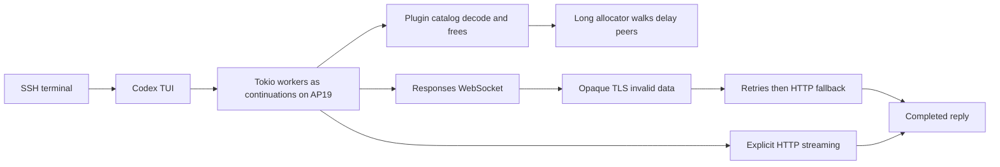

# Codex response experiments — 2026-10-14

Codex completed authenticated model replies in QEMU while its native continuations
remained on AP19. Disabling plugins recovered a reply through the existing HTTP
fallback. Explicitly selecting HTTP streaming avoided the WebSocket retry delay.
These are reversible configuration experiments; the underlying allocator and
WebSocket failures are not repaired by this report.

## Results

The experiment directory is
`bld/codex-debugger/response-probes-20261014-181456/`.
The model remained GPT-6-Astra, with its default medium reasoning setting.

| Configuration | Observation | Completion evidence |
| --- | --- | --- |
| Plugins enabled, default transport | Four remote plugin catalog fetches; AP19 eventually makes roughly 11–16 outer passes per five-second sample. Debugger samples allocation-registry insertion. | Draft-only: the initial input helper sent text and Enter together, triggering paste behavior. This run is a workload comparison, not a submitted-turn failure. |
| Plugins disabled, default transport | No remote plugin catalog fetches. WebSocket connections still fail with `invalid data`; after retry exhaustion the built-in HTTP fallback delivers `TRUEOS_OK`. TUI returns to idle after “Worked for 39s.” | Primary conversation has `response.completed`, 7 output tokens, and the final answer is rendered. The persisted conversation was not extracted before stopping this VM. |
| Plugins disabled, explicit HTTP provider | No WebSocket attempts or `invalid data` errors. HTTP response request returns 200 and the answer is rendered. | Saved primary conversation contains `final_answer: TRUEOS_OK` and `task_complete`, duration **21073 ms**. |
| Same explicit HTTP configuration, repeated run | Both the first request and a second request in the same warm session finish. | Saved primary conversation has two final answers and two `task_complete` records: **20073 ms**, then **13005 ms**. |

The warm answer is `TRUEOS_WARM_OK.` including a trailing period. This verifies
response delivery and completion, rather than exact compliance with the requested
marker spelling. The first answer is exactly `TRUEOS_OK`.

The initial submitted-turn probe incorrectly counted a nonexistent telemetry
marker and briefly reported no reply in the plugin-only run. Final review of the
primary conversation's SSE completion and terminal output corrected that result.
The subsequent HTTP runs also verify persisted assistant messages and task
completion, so their success does not depend on a working spinner or token marker
count. Background conversations and duplicate telemetry records are not counted
as additional user-turn successes.

## What the two levers explain

`features.plugins = false` removes a specific measured workload. Earlier debugger
samples resolve to PluginSummary/PluginInterface deserialization while freeing
objects. The allocator walks its address-ordered free list to validate an
allocation, then walks it again to insert the freed block. A later inspection
reaches 65536 ordered nodes without reaching the list's end. Removing the plugin
catalog work lets peers run frequently; this does not establish healthy allocator
cost for the full original workload. See
[the allocator and click/timer evidence](codex-click-timer-2026-10-14.md).

`supports_websockets = false` selects HTTP streaming before prewarming or retries.
In this source, `ModelClient::responses_websocket_enabled` uses provider capability
and session fallback state. The legacy WebSocket feature flags do not control it.
The built-in OpenAI provider also ignores ordinary configured overrides, hence
the separate provider in the [tested configuration](codex-response-experiment.config.toml).
This provider uses OpenAI's normal auth and routing. It is a custom provider
configuration, not a byte-for-byte copy of every internal built-in provider field.

The plugin-only run shows that automatic fallback already works when execution
can progress. Explicit HTTP avoids the retry detour. HTTP success does not locate
the WebSocket fault: the patched `tokio-rustls` adapter discards Rustls's concrete
`process_new_packets` error and substitutes only `InvalidData`. Codex's WebSocket
TLS configuration loads platform certificate files; inspecting the effective
trust-store size and retaining the real TLS error are discriminating next checks.
A missing CA store is still a hypothesis, not a verified diagnosis.

## Mapping to the user's concerns

| Concern | What this establishes | What remains open |
| --- | --- | --- |
| Could one application AP run the jungle before we fan out? | One Codex AP completes authentication, submission, streaming, rendering, and repeated turns under this reduced workload. | It does not establish acceptable performance with the plugin workload restored. |
| Is memory the missing clue? | Plugin deserialization/freeing, long free-list walks, and allocation-registry saturation are concrete observations. | Registry-full returns an untracked allocation; it is not itself OOM. Fragmentation, bounded allocation cost, and wider memory correctness remain separate questions. |
| Are thread bookkeeping or missing interrupt contracts responsible? | Successful turns use the existing cooperative continuations and wait handoffs. No forced AP/thread preemption or scheduler policy change was introduced. Earlier registry/fsync failures were proven lock-over-wait cycles. | Other wake, timer, TLS, or bookkeeping defects are not excluded. |
| Could an unfamiliar C ABI/system API be the trouble? | The WebSocket route fails while the HTTP route succeeds. The TLS adapter hides the specific error. A failed startup was separately sampled in `exit -> sys_halt`. | The TLS root cause and the fatal-exit carrier halt need their own narrow fixes and tests. |
| Are we merely patching symptoms? | The switches separate synchronous catalog work from transport retry costs and produce complete replies. | They are experimental controls. The allocator cost and WebSocket failure still deserve source-level corrections. |

## Reproduction and limits

`assets.json` hashes the kernel, full debugger ELF, ISO, Codex package, and module
symbols. `buildins-pins.json`, `source-state.patch`, and `kernel-build.log` preserve
the fixture inputs. Each comparison uses the same kernel and Codex build, 20
virtual CPUs, 8000 MiB RAM, a 512 MiB temporary RAM filesystem, and unchanged Codex
placement on AP19. The kernel retains the concurrently prepared Hull metadata
bridge change recorded in `source-state.patch`; it is common to these comparisons.
The experiment's own changes are configuration and capture helpers.

The image embeds pinned Codex and SQLite packages. A prelaunched default SQLite
instance was part of every fixture, but Codex still started a separate `codex`
instance through App Store. The `.env` attempt to select the default instance was
not effective; do not claim the fixture completely eliminates online service
discovery. The service reports SQLite 3.53.2 in the comparison captures. The
dynamic service's downloaded package digest was not separately extracted.

Setup-only failures are preserved separately: an earlier image could not discover
SQLite and exited after its 30-second service wait; a changing online catalog was
caught by the package guard; `.env` needed explicit Blob admission; and leaving the
disk helper required a separate input packet. None is counted as a model-turn
result. Debugger inspection of the first failure found the carrier in the ABI's
fatal-exit halt loop, distinct from the healthy response path.

`plugins-off-http-cold/reply-verification.json` and
`plugins-off-http/reply-verification.json` contain the persisted completion
evidence. Raw terminal streams, fixed serial snapshots, and phase events accompany
them. QEMU pauses are excluded from the completion durations: the successful
request observations ran without debugger stops. Later serial samples after a
pause are not treated as continuously executing time.

All VMs created for these response comparisons were stopped after captures; their
temporary auth files and RAM filesystems were destroyed. Earlier debugger VMs are
preserved independently. No physical deployment or baremetal response result is
claimed. Save the current physical configuration before merging the experimental
keys, and restore its original provider/plugin values to reverse the experiment.
