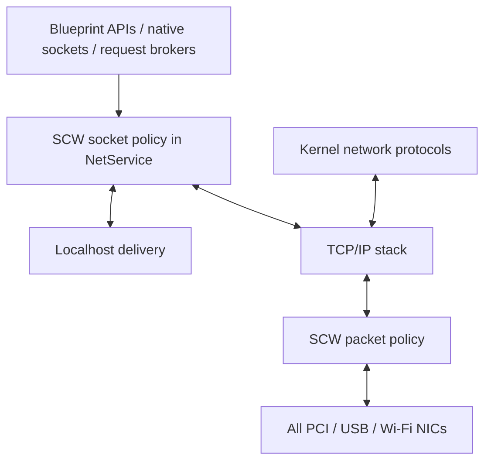

# SCW firewall funnel

SmallChinaWall (SCW) is the working name for this firewall idea. This document
persists the design and the focused source review from 2026-11-12. SCW is not
implemented; the enforcement points and rules below are proposals.

The proposed firewall has one kernel policy, enforced at two points: socket
operations and local delivery inside the network service, and packets crossing
the common NIC boundary. Together these cover localhost and physical traffic.
This proposal does not promote an app or Blueprint to a buildin.

## Existing network funnel

Blueprint network commands and native socket compatibility paths converge
through `VNet` into the kernel `NetService`. PCI, USB and Wi-Fi network data
converge on the common `ActiveDevice` / `NetDevice` boundary.

The diagram shows proposed SCW checks around existing routes. Localhost TCP and
UDP can deliver events directly inside the kernel without creating physical
packets. TCP connections to the selected interface's own IPv4 address also use
the local path. A physical packet filter alone would miss those deliveries.

Sources:

- [`VNetBridge`](../../src/hv/blueprint/blueprint_net_broker.rs) connects native
  compatibility code or VM wire sessions to host `VNet`.
- [`VNet`](../../src/r/net/mod.rs) translates API commands into adapter commands.
- [`NetService`](../../src/net/adapter.rs) owns sockets, command dispatch and
  local delivery, including `process_tcp_connect_v4_for_actor`,
  `flush_loopback_tcp_tx` and `send_loopback_udp`.
- [`ActiveDevice` and the common NIC functions](../../src/net/mod.rs) cover
  the current PCI, USB and Wi-Fi network backends.

## Focused ABI findings

The inspected ordinary TCP CABI accepts IPv4/IPv6 stream sockets using TCP; it
does not accept raw sockets. Native Mio and the Blueprint network wire also
provide UDP. ICMP echo is available, so the live API is broader than TCP/UDP.

TUN/raw-IP commands are exported through the Blueprint ABI, SDK and network
wire. However, `SendIpPacket` currently rejects valid IPv4/IPv6 packets with
`tun ip injection not implemented`. This is an exported placeholder, not a
working raw-IP injection path. The focused consumer search found no app use
beyond the SDK implementation.

No raw Ethernet/NIC or PCI/USB passthrough export was found in the inspected
Blueprint ABI. The inspected PCI/USB exports are snapshot readers. This was a
focused network ABI review, not a complete hardware-isolation audit.

Sources: [`socket_cabi.rs`](../../src/r/net/socket_cabi.rs),
[`vnet.rs`](../../crates/trueos-v/src/vnet.rs),
[`bp_abi.rs`](../../crates/trueos-v/src/bp_abi.rs),
[`blueprint_net_wire.rs`](../../src/hv/blueprint/blueprint_net_wire.rs),
[`Blueprint import registration`](../../src/hv/blueprint/blueprint.rs) and
the `SendIpPacket` handler in [`adapter.rs`](../../src/net/adapter.rs).

## Proposed socket and local-delivery enforcement

Apply the policy in `NetService` before choosing local delivery or the physical
network. Checking only higher-level API wrappers would leave other command
producers outside the policy.

- Validate the caller's ownership of a handle before policy evaluation or
  routing.
- Check TCP listeners against the app, local address, port and exposure scope.
- Check outbound TCP connections against the app, destination address and port.
- Check every UDP destination on every send. A single UDP socket can send to
  multiple endpoints, so permission to open it is insufficient.
- Check inbound application delivery, including localhost TCP and UDP.
- Keep localhost permissions distinct from LAN/public exposure. A local service
  permission must not automatically authorize an externally reachable listener.
- Define how rule changes revoke existing flows and queued local delivery.

The existing TCP authorization helpers in
[`access_key_db.rs`](../../src/access_key_db.rs) protect the reserved Codex
SQLite service endpoint. They are a narrow existing policy, not a general
firewall.

## Proposed physical packet enforcement

Screen incoming frames before they reach the TCP/IP stack and outgoing frames
before driver submission, for every NIC index. This covers kernel-generated
network traffic and any future raw-IP implementation as well as socket traffic.
Applications using sockets still cause IP packets to be emitted; filtering
incoming packets also keeps denied traffic out of the stack itself.

There are two current TX routes to cover:

| Route | Current path |
| --- | --- |
| Normal buffered TX | `AdapterTxTokenAt` -> `tx_buffer` -> `transmit_batch_at` |
| Checked UDP TX | `DirectAdapterTxTokenAt` -> `transmit_with_at` -> NIC-owned storage |

Filtering only `tx_buffer` or `transmit_batch_at` would miss checked UDP. RX
currently enters through `drain_rx_packets_each_at` and `AdapterDeviceAt`.

The direct TX API needs special handling: its fill callback returns `()` and
cannot cancel submission after inspecting the completed frame. For example,
the [R8125 driver](../../src/net/r8125.rs) fills a live DMA buffer and then
publishes the descriptor to the NIC. Final packet screening therefore needs
either a cancellable prepare/commit interface or staging before submission.
Early checked-UDP policy can reject a send with a useful error, but does not
replace complete coverage at the physical boundary.

The packet gate must apply IPv4 and IPv6 policy consistently and deliberately
handle malformed frames, VLAN tags, fragments and IPv6 extension headers.
Wi-Fi association and EAPOL are driver control traffic below the ordinary
Ethernet data boundary; their existence does not imply a Blueprint raw-NIC API.

## Proposed minimal rules

An inbound TCP/UDP port whitelist is the intended simple model for service
exposure, with these additions:

- Deny unsolicited inbound service traffic unless its destination port and
  exposure scope are allowed.
- Admit replies belonging to permitted outbound flows. UDP needs expiring
  endpoint state so replies to temporary local ports do not require opening
  those ports to arbitrary unsolicited traffic.
- Give necessary ARP, DHCP, ICMP errors and IPv6 neighbor/router discovery
  explicit kernel rules. These cannot all be expressed as service-port entries.
- Match outbound rules using app identity, protocol, destination address and
  destination port. Track admitted flows for reply handling.
- If raw-IP/TUN injection is implemented later, require explicit capability
  admission and retain physical packet enforcement.

## Identity and ownership prerequisites

The [VM network broker](../../src/hv/blueprint_net.rs) authenticates the session
VM and derives its actor. However, `VNet::submit_for_actor` currently attaches
that actor only to TCP listen/connect commands; UDP, TUN and ICMP commands do
not carry it onward. External TCP connect records also currently store the
public actor rather than preserving the originating actor.

Shared HTTP request handling retains VM ownership/generation for result access
and cancellation, but transport creation uses pooled `VNet` slots and ambient
identity. SMTP/fetch detached jobs similarly lack an explicit captured caller
principal. SCW must preserve the authenticated principal from request admission
through these helpers into socket and flow state. Queue names such as
`vnet-N@NIC` and pooled HTTP slot labels are routing labels, not app identities.
Kernel infrastructure traffic needs an explicit system identity; an app request
handled by a kernel worker must retain the app's identity.

The inspected UDP send handlers look up a numeric handle without the owner
comparison used by TCP sends. The Blueprint wire/broker does not add that
handle-owner validation. This is a source finding, not a tested exploit.
Uniform ownership validation is required before attaching firewall authority
to handles.

Sources: [`VNet::submit_for_actor`](../../src/r/net/mod.rs), the UDP/TCP handlers
in [`adapter.rs`](../../src/net/adapter.rs),
[`http_request_cabi.rs`](../../src/r/net/http_request_cabi.rs),
[`request_stream.rs`](../../src/r/net/request_stream.rs),
[`smtp_cabi.rs`](../../src/r/net/smtp_cabi.rs) and
[`https.rs`](../../src/r/net/https.rs).

## Proposed implementation order

1. Preserve caller identity through every protocol and request broker, and
   validate ownership of every referenced handle.
2. Enforce socket admission and local-delivery rules inside `NetService`.
3. Enforce stateful packet rules at every NIC, covering both TX routes and RX.

Implementation, policy-management UI, persistence format and deployment remain
future work. This document adds no firewall enforcement or runtime behavior.
