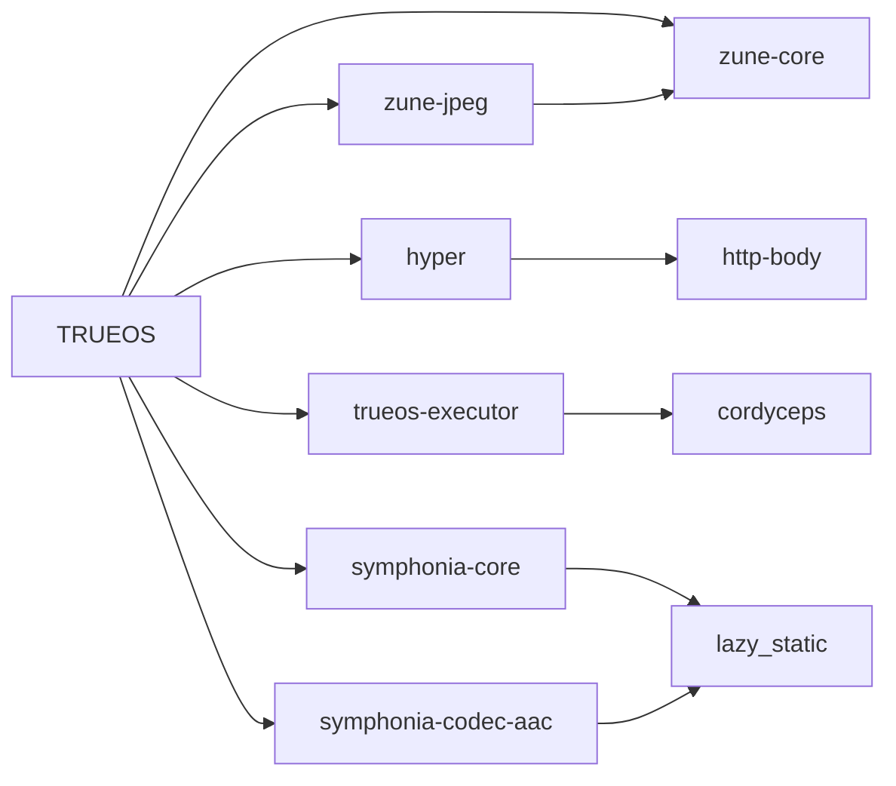

# Kernel crate upgrade audit — 2026-10-25

The best small vendored upgrades are **zune-core 0.5.1 → 0.5.3**, **http-body 1.0.1 → 1.1.0**, and **lazy_static 1.5.0 → 1.5.1**. Each has **zero textual merge conflicts** and passes an isolated check on the real TRUEOS kernel target with its local patches preserved. **cordyceps 0.3.5** is the clearest source-level unvendor candidate, with a resolver-policy tradeoff described below.

Checked public crates.io sparse indexes at 2026-10-25 01:59 CEST, against repository commit `8d92fc8c2748bce8399ce3680297b735b1269a48` and `rustc 1.99.0-nightly (af3d95584 2026-07-09)`. No repository dependencies, lockfiles, or vendor sources were changed.

Tokio is covered separately in [the Tokio upgrade addendum](tokio-crate-upgrades-2026-10-25.md): it belongs to the Blueprint app graph, rather than the selected kernel graph.

## Coverage

| Selection | Cargo units | Packages | Registry | Vendored | Other local | Sysroot | Git |
| --- | ---: | ---: | ---: | ---: | ---: | ---: | ---: |
| default | 316 | 234 | 180 | 30 | 18 | 5 | 1 |
| ttstt | 334 | 252 | 180 | 30 | 36 | 5 | 1 |

The optional `trueos_ttstt` selection adds 18 repository-owned packages and no third-party packages. The main lockfile has 319 packages; the actual default kernel selection has 234. Host build dependencies and proc macros are included, while unrelated vendor directories, tools, Blueprint app graphs, and other-target lockfile entries are not treated as kernel dependencies.

Across the 211 selected third-party package versions, **104 have newer stable releases: 18 vendored and 86 registry packages**. Of the registry packages, **22 have a newer release in the same SemVer compatibility line**; some have exact pins or must be updated together. Every queried registry record resolved successfully.

## First candidates

| Candidate | Local source delta vs published baseline | Textual upgrade conflicts | Assessment |
| --- | --- | --- | --- |
| `zune-core` 0.5.1 → [0.5.3](https://crates.io/crates/zune-core/0.5.3) | 2 files, +78/−3 lines | 0 files / 0 hunks | Best small vendor upgrade. Keep the local no_std AVX2/CPUID detection and reader patch; neither disappears in 0.5.3. |
| `http-body` 1.0.1 → [1.1.0](https://crates.io/crates/http-body/1.1.0) | 1 file, +12/−9 lines | 0 files / 0 hunks | Small vendor upgrade. Keep the no_std/alloc conversion and disabled default dependency features; upstream 1.1.0 still uses std. |
| `lazy_static` 1.5.0 → [1.5.1](https://crates.io/crates/lazy_static/1.5.1) | 1 file, +1/−1 lines | 0 files / 0 hunks | Small vendor upgrade. Keep the explicit static lifetime and spin 0.10 policy. Update both Symphonia direct paths together to avoid duplicate versions. |
| `cordyceps` 0.3.5 | 0 files, +0/−0 lines | No upgrade needed | No newer release, but no source delta. Published code compiles for the kernel. Removing the manifest patch restores cfg(loom) dependencies to resolution; see below. |

The following useful registry candidates have no vendored fork to port: `serde_json` 1.0.151 → 1.0.154, `twox-hash` 2.1.4 → 2.1.5, `webpki-roots` 1.0.9 → 1.0.11, and `zeroize` 1.9.0 → 1.9.1. A second batch could cover `rustls` 0.23.43 → 0.23.46 with `rustls-webpki` 0.103.15 → 0.103.16. These are selection candidates, not compiled upgrades; inspect target features and the resulting graph when updating.

## Keeping the graph tight



A temporary root manifest and temporary lockfile were used to plan the default kernel with the three merged upgrades plus published cordyceps. With both Symphonia lazy_static paths updated, the graph remains **234 packages / 316 units**, with **no new package names**. Only the three intended package versions change. This is a Cargo planning check, not a full kernel compilation.

Overriding only `[patch.crates-io].lazy_static` leaves the Symphonia paths selecting 1.5.0 while another consumer selects 1.5.1: **235 packages**. A real upgrade must update `vendor/symphonia-core-0.5.5-trueos/Cargo.toml` and `vendor/symphonia-codec-aac-0.5.5-trueos/Cargo.toml` as well. Upstream lazy_static still requests spin 0.9.8, so dropping its manifest patch would also defeat the shared spin 0.10 policy.

Cordyceps is identical to published 0.3.5 in the source files measured, and its stored VCS revision matches that release. Its only semantic manifest differences remove `cfg(loom)` dependencies on Loom and tracing. Restoring the published manifest adds the Loom/tracing family to lockfile resolution, while the selected normal kernel graph stays unchanged. Therefore unvendoring is easy for the normal build but conflicts with the existing manifest comment's broader all-target dependency policy. Keep the vendor if that broader policy is intentional.

## Complete active vendor inventory

The baseline is the checksum-verified published archive with the local package version; `infer` uses 0.22.0 as the baseline for 0.22.0-trueos.1. A matching version alone does not prove the historical fork point. See JSON for VCS evidence, individual changed files, conflicting source filenames, manifest differences, parent consumers, features, and source/archive URLs.

**Counts include inline test modules removed from source files.** Tests/examples/docs/tools directories and non-code assets are excluded. Thus large deletion counts, particularly in smoltcp and Symphonia, do not represent only production logic. Conflicts below are conservative textual three-way source merge estimates. Manifest key disagreements are recorded separately in JSON, and a clean textual merge does not prove API or runtime compatibility.

| Crate | Current | Newest stable | Local source files | Added / removed lines | Conflicts to newest stable, files / hunks |
| --- | --- | --- | ---: | ---: | --- |
| `acpi` | 6.1.1 | [6.1.1](https://crates.io/crates/acpi/6.1.1) | 9 | +10 / −10 | — |
| `alsa` | 0.11.0 | [0.12.1](https://crates.io/crates/alsa/0.12.1) | 5 | +935 / −3 | 1 file / 2 hunks |
| `aml` | 0.16.4 | [0.16.4](https://crates.io/crates/aml/0.16.4) | 3 | +4 / −42 | — |
| `cordyceps` | 0.3.5 | [0.3.5](https://crates.io/crates/cordyceps/0.3.5) | 0 | +0 / −0 | — |
| `crab-usb` | 0.9.1 | [0.12.1](https://crates.io/crates/crab-usb/0.12.1) | 31 | +2023 / −413 | 19 files / 66 hunks |
| `crc32fast` | 1.5.0 | [1.5.3](https://crates.io/crates/crc32fast/1.5.3) | 6 | +94 / −136 | 3 files / 9 hunks |
| `dma-api` | 0.7.3 | [0.10.2](https://crates.io/crates/dma-api/0.10.2) | 1 | +2 / −2 | 0 files / 0 hunks |
| `embedded-websocket` | 0.9.4 | [0.9.5](https://crates.io/crates/embedded-websocket/0.9.5) | 2 | +21 / −572 | 2 files / 4 hunks |
| `fdeflate` | 0.3.7 | [0.3.7](https://crates.io/crates/fdeflate/0.3.7) | 5 | +18 / −290 | — |
| `http` | 1.4.0 | [1.5.0](https://crates.io/crates/http/1.5.0) | 20 | +253 / −1573 | 3 files / 3 hunks |
| `http-body` | 1.0.1 | [1.1.0](https://crates.io/crates/http-body/1.1.0) | 1 | +12 / −9 | 0 files / 0 hunks |
| `httpdate` | 1.0.3 | [1.0.3](https://crates.io/crates/httpdate/1.0.3) | 2 | +146 / −108 | — |
| `hyper` | 1.10.0 | [1.12.0](https://crates.io/crates/hyper/1.12.0) | 55 | +1054 / −4521 | 17 files / 42 hunks |
| `infer` | 0.22.0-trueos.1 | [0.22.0](https://crates.io/crates/infer/0.22.0) | 4 | +736 / −539 | — |
| `lazy_static` | 1.5.0 | [1.5.1](https://crates.io/crates/lazy_static/1.5.1) | 1 | +1 / −1 | 0 files / 0 hunks |
| `microfont` | 3.9.9 | [3.9.9](https://crates.io/crates/microfont/3.9.9) | 19 | +2049 / −821 | — |
| `mio` | 1.2.0 | [1.2.4](https://crates.io/crates/mio/1.2.4) | 63 | +1630 / −3423 | 12 files / 23 hunks |
| `png` | 0.18.1 | [0.18.1](https://crates.io/crates/png/0.18.1) | 18 | +264 / −3218 | — |
| `ring` | 0.17.14 | [0.17.14](https://crates.io/crates/ring/0.17.14) | 26 | +77 / −103 | — |
| `rustls-rustcrypto` | 0.0.2-alpha | prereleases only | 9 | +7 / −300 | — |
| `simd-adler32` | 0.3.8 | [0.3.10](https://crates.io/crates/simd-adler32/0.3.10) | 8 | +17 / −387 | 8 files / 8 hunks |
| `smoltcp` | 0.13.1 | [0.14.0](https://crates.io/crates/smoltcp/0.14.0) | 66 | +230 / −15745 | 21 files / 34 hunks |
| `sunset` | 0.5.0 | [0.6.0](https://crates.io/crates/sunset/0.6.0) | 7 | +126 / −8 | 1 file / 1 hunk |
| `symphonia-codec-aac` | 0.5.5 | [0.6.1](https://crates.io/crates/symphonia-codec-aac/0.6.1) | 10 | +34 / −362 | 7 files / 11 hunks |
| `symphonia-core` | 0.5.5 | [0.6.1](https://crates.io/crates/symphonia-core/0.6.1) | 26 | +169 / −4957 | 23 files / 35 hunks |
| `tinyaudio` | 2.0.0 | [2.0.0](https://crates.io/crates/tinyaudio/2.0.0) | 10 | +333 / −49 | — |
| `usb-if` | 0.7.0 | [0.8.0](https://crates.io/crates/usb-if/0.8.0) | 3 | +54 / −43 | 1 file / 1 hunk |
| `want` | 0.3.1 | [0.3.2](https://crates.io/crates/want/0.3.2) | 1 | +15 / −177 | 1 file / 1 hunk |
| `zune-core` | 0.5.1 | [0.5.3](https://crates.io/crates/zune-core/0.5.3) | 2 | +78 / −3 | 0 files / 0 hunks |
| `zune-jpeg` | 0.5.15 | [0.5.15](https://crates.io/crates/zune-jpeg/0.5.15) | 11 | +27 / −460 | — |

Intermediate and preview choices:

| Crate | Target | Textual conflicts | Interpretation |
| --- | --- | --- | --- |
| `crab-usb` | [0.9.10](https://crates.io/crates/crab-usb/0.9.10) | 11 files / 15 hunks | Same SemVer line, but already substantial overlap; not a first upgrade. |
| `usb-if` | [0.7.5](https://crates.io/crates/usb-if/0.7.5) | 1 file / 1 hunk | Same line; one parser conflict. Keep local endpoint/parser behavior and logging policy. |
| `acpi` | [7.0.0-pre1](https://crates.io/crates/acpi/7.0.0-pre1) | 3 files / 3 hunks | Prerelease and a breaking major; current stable is already latest. |
| `zune-jpeg` | [0.5.16-rc3](https://crates.io/crates/zune-jpeg/0.5.16-rc3) | 6 files / 6 hunks | Prerelease; current stable is already latest. |

`dma-api` has only a 2-line source substitution and a clean text merge to 0.10.2, but it is **not** a small graph update: the root requires `=0.7.3`, CrabUSB requires `0.7`, and 0.10.2 crosses incompatible 0.x lines. Treat it with the USB stack. `sunset` 0.6.0 has just one textual conflict, but crosses an incompatible line and needs a review of local SSH behavior and dependency changes.

Defer `hyper`, `mio`, `smoltcp`, and Symphonia for focused work: their newest stable versions produce 42, 23, 34, and 35/11 source conflict hunks respectively. Even small patch bumps are not uniformly cheap: crc32fast 1.5.3 has 9 conflict hunks and simd-adler32 0.3.10 has 8.

## Registry upgrades within the current SemVer line

These packages have no local vendor changes in this kernel graph. Depth is the shortest package-edge distance from TRUEOS, including build dependencies; 1 means a direct dependency. Host roles include proc macros and build helpers. A same-line release does not bypass exact pins, feature constraints, or coordination with a matching derive crate.

| Crate | Locked | Same-line target | Depth | Role | Constraint / coordination |
| --- | --- | --- | ---: | --- | --- |
| `bitflags` | 2.13.1 | [2.13.2](https://crates.io/crates/bitflags/2.13.2) | 2 | kernel | No exact pin found in the recorded parent declarations. |
| `cc` | 1.4.4 | [1.10.0](https://crates.io/crates/cc/1.10.0) | 2 | host | Host C build tool for ring; larger minor jump despite SemVer compatibility. |
| `cfg-if` | 1.0.4 | [1.0.5](https://crates.io/crates/cfg-if/1.0.5) | 2 | host, kernel | No exact pin found in the recorded parent declarations. |
| `find-msvc-tools` | 0.1.11 | [0.1.15](https://crates.io/crates/find-msvc-tools/0.1.15) | 3 | host | No exact pin found in the recorded parent declarations. |
| `generic-array` | 0.14.7 | [0.14.9](https://crates.io/crates/generic-array/0.14.9) | 3 | host, kernel | Blocked by crypto-common =0.14.7; do not force as an independent update. |
| `litrs` | 1.0.0 | [1.0.1](https://crates.io/crates/litrs/1.0.1) | 3 | host | No exact pin found in the recorded parent declarations. |
| `rand` | 0.8.7 | [0.8.8](https://crates.io/crates/rand/0.8.8) | 4 | kernel | No exact pin found in the recorded parent declarations. |
| `redb` | 4.2.0 | [4.4.0](https://crates.io/crates/redb/4.4.0) | 1 | host, kernel | Review experimental-api-5 and storage compatibility before treating as routine. |
| `rustls` | 0.23.43 | [0.23.46](https://crates.io/crates/rustls/0.23.46) | 1 | host, kernel | No exact pin found in the recorded parent declarations. |
| `rustls-webpki` | 0.103.15 | [0.103.16](https://crates.io/crates/rustls-webpki/0.103.16) | 2 | kernel | No exact pin found in the recorded parent declarations. |
| `serde_json` | 1.0.151 | [1.0.154](https://crates.io/crates/serde_json/1.0.154) | 1 | host, kernel | No exact pin found in the recorded parent declarations. |
| `sha1` | 0.10.6 | [0.10.7](https://crates.io/crates/sha1/0.10.7) | 2 | kernel | Explicit trueos-crypto =0.10.6 pin; deliberate manifest change required. |
| `smallvec` | 1.15.2 | [1.16.4](https://crates.io/crates/smallvec/1.16.4) | 2 | kernel | No exact pin found in the recorded parent declarations. |
| `syn` | 3.0.4 | [3.0.9](https://crates.io/crates/syn/3.0.9) | 3 | host | No exact pin found in the recorded parent declarations. |
| `thiserror` | 2.0.20 | [2.0.21](https://crates.io/crates/thiserror/2.0.21) | 2 | host, kernel | Update with thiserror-impl. |
| `thiserror-impl` | 2.0.20 | [2.0.21](https://crates.io/crates/thiserror-impl/2.0.21) | 3 | host | Parent currently requires =2.0.20; update with thiserror. |
| `twox-hash` | 2.1.4 | [2.1.5](https://crates.io/crates/twox-hash/2.1.5) | 1 | kernel | No exact pin found in the recorded parent declarations. |
| `unicode-ident` | 1.0.24 | [1.0.27](https://crates.io/crates/unicode-ident/1.0.27) | 4 | host | No exact pin found in the recorded parent declarations. |
| `webpki-roots` | 1.0.9 | [1.0.11](https://crates.io/crates/webpki-roots/1.0.11) | 1 | kernel | No exact pin found in the recorded parent declarations. |
| `zerocopy` | 0.8.56 | [0.8.63](https://crates.io/crates/zerocopy/0.8.63) | 2 | host, kernel | Update with zerocopy-derive. |
| `zerocopy-derive` | 0.8.56 | [0.8.63](https://crates.io/crates/zerocopy-derive/0.8.63) | 3 | host | Parent currently requires =0.8.56; update with zerocopy. |
| `zeroize` | 1.9.0 | [1.9.1](https://crates.io/crates/zeroize/1.9.1) | 1 | kernel | No exact pin found in the recorded parent declarations. |

The other registry upgrade opportunities mostly cross incompatible lines in the RustCrypto, rand, and supporting ecosystems. Upgrading these individually can add parallel crate versions rather than simplify the graph. The full inventory, including all 86 registry packages with a newer stable version, is in the adjacent TSV and JSON; both distinguish newest stable from the newest same-line release. SHA-2 is deliberately pinned to `=0.10.9`. The git-pinned experimental x86_64 implementation should be evaluated against its pinned upstream revision, not replaced based only on a registry version number.

## Validation and reproduction

An isolated no_std probe compiled unmodified published cordyceps 0.3.5 and the three merged candidates using the repository's actual `.cargo/x86_64-unknown-trueos.json` target and nightly toolchain. Local source patches were applied by three-way merge; lazy_static retained spin 0.10, http-body retained its no_std dependency settings, and zune-core retained its local CPU detection. All passed. The probe does not test all kernel callers, boot behavior, TLS/network traffic, codecs, or storage. No full kernel build or boot test was run.

The audit script plans graphs without compiling or running build scripts. It refreshes public sparse indexes, verifies downloaded archives against registry SHA-256 checksums, compares source and semantic manifest changes, and runs `git merge-file` against newer published sources. It writes JSON and TSV. The prose findings and separate temporary compile/graph experiments in this dated Markdown report are a reviewed snapshot, rather than generated upgrade approval.

```sh
python3 tools/audit/kernel_crate_upgrades.py --out tools/docs/kernel-crate-upgrades-2026-10-25
# Reuse this run's registry snapshot and downloaded archives:
python3 tools/audit/kernel_crate_upgrades.py --cached-index --out /tmp/kernel-crate-upgrades
```

Registry and archive caches, merged candidate sources, probe code/log, and temporary graph manifests/lockfiles are under `/tmp/trueos-kernel-crate-audit/`. The checked-in JSON includes the successful probe log and graph comparison; temporary paths are only reproducible while that directory is retained. Parent declaration records can include inactive target alternatives where a parent also selects the same crate on its active target; these records are review aids, not a replacement for Cargo resolution.
