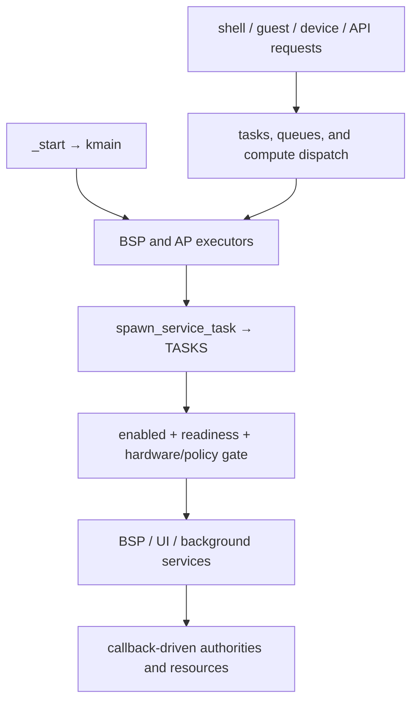

# TRUEOS services tasks and pools

TRUEOS runs per-CPU executors, a readiness-gated boot registry, and request-driven tasks for devices, commands, guests, and compute work. **No local LLM inference service is wired into the kernel.** Spirit remains integrated with Codex; TTSTT/Kokoro is the optional speech path for future voice/text work.

Updated 2 November 2026 after [runtime retirement](runtime-retirement.md). Scope is the root kernel, `src/**`, and repository-owned `crates/**`, excluding vendor. The kernel entry is [src/main.rs](../../src/main.rs); there is no separate `kernel/` directory.

## Inventory map

| Inventory | Contents |
| --- | --- |
| [Cleanup decisions and facts](runtime-retirement.md) | Removed features, atomic-bomb explanation, unused cache, preserved Spirit APIs, and callback-driven laptop status panel. |
| [Kernel execution](runtime-kernel.md) | Boot/poll paths, CPU placement, threads, blocking/compute pools, callback authorities, and all remaining boot-registry entries. |
| [Drivers and application services](runtime-services.md) | USB, networking, storage, guests, Shell3, UI4/GPU/audio, TTSTT, resource pools, and caller traces. |
| [Repository crates](runtime-crates.md) | All 34 workspace packages, executor/macro infrastructure, ABI clients, interpreters, resource arenas, and host shader tools. |
| [Every task declaration](runtime-task-index.md) | Current source locations, storage capacities, and links to reviewed trace reports. |
| [Lexical data](runtime-inventory-data.json) | Declarations, candidate calls, registry constructors, service-named files, and pool-related symbols. |
| [Reviewed registry records](runtime-registry.json) | Features, initial admission state, readiness, gates, wrappers, placement, and usage notes. |

## Current counts

| Measure | Count | Meaning |
| --- | ---: | --- |
| Rust files scanned | 796 | All owned Rust under src/crates, across cfg variants. |
| Task declarations | 130 | 128 normal src declarations, one uncompiled turbo reference, and one graphics declaration. A declaration is not a running instance. |
| Macro task template | 1 | Kept separate; documentation examples are excluded. |
| Default registry entries | 63 | Includes three explicitly disabled entries and readiness/hardware gates. |
| All-feature registry entries | 67 | 62 base + one H264 + two TTSTT + two legacy checkpoint entries. |
| Workspace packages under crates | 34 | Graphics and shader source directories are additional non-package directories. |

Default features enable H264 streaming, task profiling, and native GPGPU. TTSTT and legacy checkpoints are opt-in; the old Lumen feature has been removed. Three registry entries remain explicitly disabled: Unix FD probe, Intel HDA audio demo, and RAPL service. TTSTT residency also remains blocked by its false warm policy, with no lazy-start caller found.

## Ownership and use



Task-storage capacity is the number of simultaneous instances of one declared task type. CPU carriers, native-thread admission, blocking lanes, and reusable resource pools have different ownership rules. The reports keep those separate. An idle service awaiting a request is still wired.

A reviewed trace follows declaration → constructor/start helper → spawner or registry/callback/ABI → gate → request producer/consumer. For example, codec requests reach boot-started codec workers and the bounded CPU compute pool. PNG row expansion has a spawn route but is blocked by `PNG_ROW_EXPAND_POOL_ENABLED=false`. The BF16 boot-exercise and legacy USB boot-mouse tasks have no token caller found. The disconnected media-control helper and the two-controller/singleton USB event-pump capacity issue remain documented for later work.

Print discovery and its spooler are boot-wired, but current print submission rejects every document and no queue producer was found. Registry `started` records admission, not a heartbeat or full-pool count; readiness bits record milestones. These facts prevent confusing retained implementation with actual use.

## Regeneration and limits

```sh
python3 tools/runtime_inventory.py
```

The script regenerates the task index and lexical JSON. Reviewed prose and registry records require review after source changes. Calls sharing a name are candidates until module/import/cfg resolution is checked. Static wiring does not prove runtime health; vendor bodies, sibling consumers, and loaded applications are outside the lexical scan. The cleanup separately checked the sibling Spirit API consumers to preserve Codex integration.
