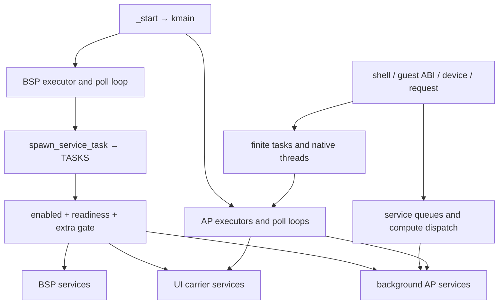

# TRUEOS services tasks and pools

The kernel starts one executor per CPU and a central registry that admits services after their readiness and hardware gates open. Commands, device discovery, guest APIs, and compute requests create additional tasks outside that registry. Worker pools, task storage, and reusable resource pools have different owners and capacities; they are organized separately below.

This inventory covers the root kernel, `src/**`, and repository-owned `crates/**`, excluding `vendor/**`. The kernel entry is [src/main.rs](../../src/main.rs#L135); there is no separate `kernel/` directory. Snapshot: **30 October 2026**, commit `27f1144493181e21cac9669122f2c95ffeae6d57`, with no pre-existing working-tree changes.

## Inventory map

| Inventory | Contents |
| --- | --- |
| [Kernel and execution](runtime-kernel.md) | Boot and poll paths, CPU placement, threads, blocking lanes, compute pools, filesystem/network services, Spirit, callback authorities, and every central registry entry. |
| [Drivers and application services](runtime-services.md) | AI, USB, block devices, VM lifecycle, Shell3, audio, UI4, GPU services, resource pools, and command-driven tasks. |
| [Repository crates](runtime-crates.md) | All 34 workspace packages, executor infrastructure, ABI clients, compute interpreters, graphics pools, and host shader tools. |
| [Every task declaration](runtime-task-index.md) | Complete declaration index with file locations and task-storage capacities. Includes optional features and the turbo reference overlay. |
| [Machine-readable declarations](runtime-inventory-data.json) | Lexical task/caller candidates, registry constructors, service-named files, and named pool symbols. |
| [Reviewed registry records](runtime-registry.json) | All 77 possible registry entries with features, gates, wrappers, placement, and source locations. |

## Counts and status meanings

| Measure | Count | Interpretation |
| --- | ---: | --- |
| Rust files scanned | 793 | All Rust source under `src` and `crates`, across cfg variants. |
| Concrete task declarations | 146 | 144 in normal `src` source, one in the turbo reference overlay, and one in `crates/trueos-graphics`. Declarations are not running instances. |
| Procedural macro task template | 1 | Kept separate from concrete task declarations; documentation examples are excluded. |
| Boot registry entries with default features | 72 | Includes eight explicitly disabled entries and services waiting for gates. |
| Boot registry entries across all features | 77 | 71 base, one H264 entry, one Lumen entry, two TTSTT entries, two legacy checkpoint entries. |
| Repository workspace packages under `crates` | 34 | Graphics and shader source directories are additional non-package directories. |

The default features are `trueos_h264_encode_stream`, `trueos_task_profile`, and `odin-native-gpgpu` ([Cargo.toml:85](../../Cargo.toml#L85)). `trueos_lumen`, `trueos_ttstt`, and `legacy_vm_checkpoint` are excluded by default. Workspace membership and an open IDE tab do not establish runtime use.

**Boot** means startup reaches the admission code. **Conditional** adds a feature, policy, topology, readiness, or hardware condition. **On demand** means a command, request, or event reaches a task constructor or service API. **Disabled** means an explicit switch blocks the traced route. **No in-tree caller** means the scan found no incoming source path; exported ABI functions and externally loaded Blueprints can have consumers outside this scope. An idle service awaiting requests remains a wired service.

## Execution and ownership



| Kind | Owner and examples | How to read capacity |
| --- | --- | --- |
| CPU executors and carriers | `percpu`, `runtime`, `workers`; BSP, UI carrier, background APs, reserved application lanes | A carrier is a CPU/executor selected by placement policy. It may host many cooperative tasks. |
| Task storage pools | `#[task(pool_size = N)]` → executor `TaskPool` | `N` simultaneous instances of that task type, independent of CPU count. The task index lists every declaration. |
| Native continuations and blocking lanes | `r::threads`, `r::blocking`, WLS leases | Native thread tasks and synchronous service-lane queues have separate admission and ownership rules. |
| Compute pools | `CpuTaskPool`, `CODEC_COMPUTE`, optional `CPU_VNNI_ROW_POOL` | Shared task storage cap 32; individual pools impose lower caps and acquire compute leases. |
| Resource pools and arenas | UI4 frames, scanout surfaces, network packets, USB device queues, live-update page tables, VM IDs/stacks, tensor arenas | Reusable storage or ownership slots; these do not themselves create workers. |
| Service APIs without a task | IDE source/workspace, Codex input, MicroFont masks, Hull font cache, VCopy, crate `v` clients | The caller, parent future, or registered callback drives execution. |

## Dormant paths and disconnected startup

| Finding | Static trace and consequence |
| --- | --- |
| Eight registry entries disabled | `executor-realm-migration-smoke`, `trueosfs-rw-probe`, `unix-fd-probe`, `ftp-server`, `tga`, `intel-hda-audio-demo`, `raple-service`, `atomic_bomb`. The [full registry](runtime-kernel.md#central-boot-registry) links each wrapper and gate. No in-tree registry re-enable API was found. |
| Unix FD probe flag has no effect on admission | Both branches of [unix_fd_probe_task_spec](../../src/r/services/spawn_service.rs#L1182) return `TaskSpec::disabled`. Changing the probe constant alone cannot enable startup. |
| Network throughput benchmark suppressed | The registry entry is enabled, but [its wrapper](../../src/r/services/spawn_service.rs#L547) returns `Skipped` while `THROUGHPUT_BENCH_AUTOSTART=false` ([allcaps:185](../../src/allcaps.rs#L185)). |
| PNG parallel expansion disabled | [PNG_ROW_EXPAND_POOL_ENABLED=false](../../crates/trueos-graphics/decoder/png_decode_pool.rs#L14) directs both expansion entry points to serial work. The 16-slot task pool has a spawn implementation but is dormant under this constant. |
| BF16 exercise has no caller | [bf16_helper_boot_exercise_task](../../src/turbo/avx2_fma_sse2_help.rs#L220) has no token-construction caller in the scanned tree. SIMD helper functions in the same module have consumers. |
| USB boot-mouse worker disconnected | [usb_boot_mouse_worker_task](../../src/usb3/dev_gears.rs#L186) has no caller; its handoff helper also has no caller. The current HID route uses boot streams. |
| USB LED and media-control helpers disconnected | Task constructors occur inside start helpers, but those helpers have no caller found. See [leds:465](../../src/usb3/hid/leds.rs#L465), [leds:526](../../src/usb3/hid/leds.rs#L526), and [mediacontrol:299](../../src/usb3/hid/mediacontrol.rs#L299). |
| TTSTT residency controller blocked twice | `trueos_ttstt` is off by default; with the feature enabled, [BOOT_RESIDENT_WARM_ENABLED=false](../../src/allcaps.rs#L108) disables its registry entry. The only caller found for `ensure_service_started` is [that registry wrapper](../../src/r/services/spawn_service.rs#L328); the documented lazy command path has no caller found. |
| Optional AI and checkpoint paths | Lumen inference workers and its 16-cap VNNI row pool require `trueos_lumen`; legacy VM store/replication require `legacy_vm_checkpoint`. These are feature exclusions, rather than missing implementations. |
| Print spooler has no admitted-job route | The spooler is boot-wired, but [print2d::submit_for_owner](../../src/r/print2d.rs#L171) unconditionally returns `ERROR_INVALID_DOCUMENT`, and no pending-queue producer was found. Printer discovery and the IPP transport implementation remain separate wired paths. |
| Unused crate facilities and archived code | `Realm` has no in-tree constructor use; VM demo minute logger has no caller found; `avl_old.rs` is not declared as a module. The [crate inventory](runtime-crates.md) distinguishes these from active raw executors, guest idle entry, and other math code. |
| Turbo reference overlay | `src/turbo/trueos-lumen-cpu-vnni/reference` and its `files/crates` copies are patch/reference material, not another set of live kernel workers. The compiled warm task is in `src/ai`. |

## Static issues that affect interpretation

The USB controller path admits up to two controllers ([usb3/mod.rs:24](../../src/usb3/mod.rs#L24)); each successfully initialized normal controller allocates `usb_event_pump_task` ([line 173](../../src/usb3/mod.rs#L173)). That task uses the macro's default **one** storage slot ([line 459](../../src/usb3/mod.rs#L459)). If the first pump remains alive, a second allocation returns busy. This is a source-level capacity mismatch, not a reproduced hardware failure.

The registry's `started` bit records successful wrapper admission. It does not automatically clear when a task returns, and multi-task wrappers can admit only part of a pool. Likewise, readiness flags record milestones. Neither field establishes present task health or the number of live workers ([orchestrator](../../src/r/services/spawn_service.rs#L1895), [snapshot](../../src/r/services/spawn_service.rs#L1846)).

The startup manifest currently marks every listed application action `skip` ([startup.json](../../startup.json#L18)). A wired `bp-autostart` controller therefore does not imply that those applications launch. Manifest reload and explicit shell/guest launches remain separate incoming paths.

## Brief static analysis trace

For each task or service, the reviewed tables connect declaration → constructor or start helper → spawner, registry, callback, or ABI export → startup gate → queue producer or consumer where applicable. Three representative traces show why the classifications differ:

1. **Used compute route:** `_start` → `kmain` → central registry → `codec-service` → `spawn_codec_service` → `codec_worker_task`; archive/LZ4 requests reach codec workers and `CODEC_COMPUTE`. Both startup and request consumers exist ([wrapper](../../src/r/services/spawn_service.rs#L371), [worker](../../src/r/codec.rs#L1054), [compute dispatch](../../src/r/lz4.rs#L251)).
2. **Policy dormant route:** graphics module → PNG decode → row-expansion entry → constant false → serial processing. The parallel constructor has callers in source, but the constant blocks their route ([entry](../../crates/trueos-graphics/decoder/png_decode_pool.rs#L389)).
3. **No incoming route found:** turbo module → BF16 helper task declaration; searching task-constructor calls yields no incoming caller. That finding applies to this task, not the whole SIMD module ([declaration](../../src/turbo/avx2_fma_sse2_help.rs#L220)).

The lexical index strips comments and strings, records all task attributes, separates macro templates, extracts `TaskSpec` constructors, and records candidate calls and named pool symbols. Reviewed traces resolve duplicate function names, imports, features, aliases such as `usb2`, `#[path]` modules such as graphics, explicit disabling, and request-driven APIs. The 78 constructor expressions in JSON include both Unix FD branches; they represent 77 possible registry entries.

Regenerate the lexical declaration and call-candidate outputs from the repository root:

```sh
python3 tools/runtime_inventory.py
```

The reviewed prose and registry records are a dated snapshot and need manual review after code changes. This is static analysis across cfg variants, not a compiler-resolved whole-program call graph or a runtime liveness measurement. Vendor bodies, sibling repositories, generated build outputs, and external application consumers are outside the scan. Existing service snapshots and pool counters that can confirm live behavior are listed in the kernel inventory.
