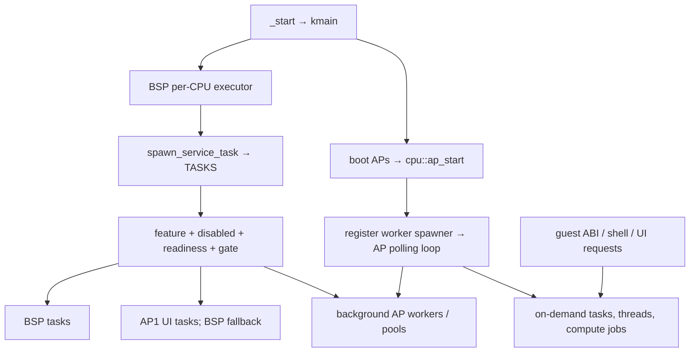

# TRUEOS kernel services tasks and pools

[Overview](runtime-inventory.md) · [Task declarations](runtime-task-index.md)

Static inspection on 2026-10-30 of the current working tree. No source changes, no boot or runtime trace collected. Paths below are repository-relative. **Boot-wired** means a source path exists from `_start`/`kmain`; **conditional** adds a feature, readiness, hardware, topology, or policy gate; **on-demand** means an API/event must submit work; **disabled** means an explicit startup switch prevents the registry from invoking it. Allocation and execution can still fail. These states do not prove a service is currently running.

## Boot and polling trace

- `_start` ([src/main.rs:135](../../src/main.rs#L135)) calls `kmain` (`:153`). BSP creates its executor (`:252`) and registers its worker spawner (`:255`). Cold boot launches APs with `cpu::ap_start` (`:293`); warm boot calls `live_update::release_warm_aps` (`:284`).
- `cpu::ap_start` ([src/cpu.rs:339](../../src/cpu.rs#L339)) initializes per-CPU state and executor; `enter_ap_runtime` (`:253`) publishes the spawner, marks online, and enters `runtime::run_ap_forever` ([src/runtime.rs:53](../../src/runtime.rs#L53)). Worker slots >1 set `BACKGROUND_AP_WORKER_READY` ([src/cpu.rs:244](../../src/cpu.rs#L244)).
- BSP `spawn_bsp_services` ([src/main.rs:302](../../src/main.rs#L302)) starts the optional task profiler and the central spawn service. `live_update::spawn_post_boot` is invoked separately (`:289`). BSP `_loop` polls time, `runtime::poll_local_executor`, and pending interrupts (`:316`). APs poll time/executor and use a local deadline plus `sti; hlt` when idle ([src/runtime.rs:53](../../src/runtime.rs#L53)). `poll_local_executor` has a per-CPU reentrancy guard (`:23`).
- Central `spawn_service_task` ([src/r/services/spawn_service.rs:1896](../../src/r/services/spawn_service.rs#L1896)) repeatedly scans `TASKS`, tests `disabled`, extra gate, and readiness mask; atomically sets `started`; calls the wrapper; resets `started` on `Skipped`/`Failed`. Retry delay is 25/150/250 ms depending on results. A normal task return does **not** clear this bit automatically.
- Readiness flags are monotonic ([src/r/readiness.rs:123](../../src/r/readiness.rs#L123)), with up to 64 concurrent watch receivers (`:98`). A set flag records a milestone, not ongoing health. `APP_VM_READY` is derived from NET + root mounted + index ready (`:59`).

## Placement and pool organization

| Executor/pool | Capacity and owner | Admission and static use |
|---|---|---|
| Per-CPU raw executors | One initialized executor per BSP/AP ([src/percpu.rs:97](../../src/percpu.rs#L97)); worker table maximum 256 slots ([src/workers.rs:18](../../src/workers.rs#L18), [src/allcaps.rs:130](../../src/allcaps.rs#L130)) | BSP and AP loops poll them. `WorkerSpawner::spawn` sends + wakes remote AP ([src/workers.rs:132](../../src/workers.rs#L132)). |
| UI/service carrier | Normally AP1; BSP fallback after all topology spawners registered ([src/workers.rs:297](../../src/workers.rs#L297)) | `spawn_on_ui_core` ([src/r/services/spawn_service.rs:224](../../src/r/services/spawn_service.rs#L224)), UI/input/Spirit services. Cooperative services can run on single CPU. |
| General background carriers | Slots >=2; LastAP reservation excluded ([src/workers.rs:319](../../src/workers.rs#L319)) | Round-robin selection; selectors prefer P-cores where applicable (`:490`). No fallback to BSP for blocking/compute. `BACKGROUND_AP_WORKER_READY` alone does not prove an eligible general carrier exists. |
| Codex application placement | LastAP reserved while `CODEX_EXECUTOR_EXPERIMENT_ENABLED=true` ([src/allcaps.rs:138](../../src/allcaps.rs#L138), [src/workers.rs:306](../../src/workers.rs#L306)) | `r::threads::submit` recognizes Codex archives and chooses role-aware carriers ([src/r/threads.rs:553](../../src/r/threads.rs#L553), [src/workers/application_policy.rs:16](../../src/workers/application_policy.rs#L16)). On demand, not an independent boot task. |
| Native thread continuations | `thread_task` and `codex_application_task` each have 256 task frames, but share a **global 256 thread admission limit** ([src/r/threads.rs:27](../../src/r/threads.rs#L27), `:542`, `:548`, `:597`) | `std_abi_shim` pthread submission ([src/std_abi_shim.rs:7603](../../src/std_abi_shim.rs#L7603)) → `r::threads::spawn` (`:671`) → `submit` → appropriate executor task. Captures VM ownership, stack, WLS identity; guest VMCall path also supported (`:671`, `:707`). |
| Blocking service lanes | Task storage maximum 256 ([src/r/blocking.rs:31](../../src/r/blocking.rs#L31), `:342`), one persistent lane task per eligible registered slot | BSP dispatcher (`:400`) calls `start_service_lanes` every 250 ms. Host/guest submit APIs (`:784`, `:794`, `:806`, `:842`) enqueue bounded requests under lane leases. Shared queue cap 4094 (`:25`). Work runs synchronously inside AP poll; this pool is distinct from native thread continuations. |
| CPU compute task storage | Shared maximum **32** task frames ([src/allcaps.rs:55](../../src/allcaps.rs#L55), [src/cpu_task_pool.rs:323](../../src/cpu_task_pool.rs#L323)) | `CpuTaskPool::try_dispatch` (`:69`) reserves pool capacity and an exclusive compute lease, then spawns a finite closure task. `run` (`:120`) retries admissible transient failures and awaits completion. Exclusive only among compute clients; normal executor work still shares the carrier ([src/workers.rs:413](../../src/workers.rs#L413)). |
| `CODEC_COMPUTE` | Static cap 4, `PerformanceFirst` ([src/r/codec.rs:13](../../src/r/codec.rs#L13)) | Used for archive pack/unpack (`:664`, `:831`) and LZ4 encode/decode ([src/r/lz4.rs:251](../../src/r/lz4.rs#L251), `:267`, `:298`, `:341`). CPU work has explicit callers; it is not dormant. |
| Codec request workers | Task pool 4 ([src/r/codec.rs:12](../../src/r/codec.rs#L12), `:1054`); request queue 32, operation table 64 | Registry `codec-service` → `spawn_codec_service` ([src/r/services/spawn_service.rs:371](../../src/r/services/spawn_service.rs#L371)), waits for topology registration, starts up to four background workers. Workers dequeue archive/LZ4 requests. |
| VMedia image/video | Image task pool 4 ([src/r/services/media_service.rs:632](../../src/r/services/media_service.rs#L632)); video task pool 3 ([src/r/services/video_service.rs:425](../../src/r/services/video_service.rs#L425)) | Registry `vmedia-service` → wrapper ([src/r/services/spawn_service.rs:417](../../src/r/services/spawn_service.rs#L417)): explicitly starts three video futures even on one available carrier, then up to four image workers. Actual decode/playback waits for queued requests. |
| Hull image workers | Task pool 2 ([src/r/services/hull_image_service.rs:396](../../src/r/services/hull_image_service.rs#L396)) | Lazy `ensure_workers` (`:117`) from `request` (`:160`); UI4 Hull image ABI calls it ([src/ui4/blueprint_ui4/hull_image_api.rs:160](../../src/ui4/blueprint_ui4/hull_image_api.rs#L160)). Boot registry does not start this pool. |
| Short-lived launch/playback | Archive launch pool 4 ([src/r/io/fs_cabi.rs:2622](../../src/r/io/fs_cabi.rs#L2622)), image-viewer launch pool 4 ([src/r/services/image_open_service.rs:33](../../src/r/services/image_open_service.rs#L33)), video playback pool 3 ([src/r/services/video_open_service.rs:45](../../src/r/services/video_open_service.rs#L45)) | Guest FS/launch/video requests pick background worker, create task, and return admission result. See task table. |
| Spirit | Four reserved fence channels, runtime worker limit 1 ([src/spirit/mod.rs:105](../../src/spirit/mod.rs#L105)); four distinct task types each with pool size 1 | Registry `trueos-spirit` → frame + cursor pair, then selection + thoughts ([src/r/services/spawn_service.rs:675](../../src/r/services/spawn_service.rs#L675)). Requires usable hardware, complete scanout, and UI carrier. Unactivated fence channels are spare capacity, not four running workers. |
| Readiness subscription pool | 64 watch receiver slots ([src/r/readiness.rs:98](../../src/r/readiness.rs#L98)) | Supporting synchronization storage; not an executor or worker pool. |
| Chronos subscriptions | Dynamic weak-reference subscriber list ([src/chronos/signals.rs:59](../../src/chronos/signals.rs#L59)) | One boot `service_task` publishes each 100 ms; Shell3 minute subscription exists ([src/shell3/shell3.rs:752](../../src/shell3/shell3.rs#L752)). Dropped subscriptions are pruned. |

## Extra gates and hidden startup conditions

Registry gate implementations are in [src/r/services/spawn_service.rs](../../src/r/services/spawn_service.rs) unless specified:

| Gate | Static condition |
|---|---|
| `codex_progress_gate` (`:606`) | `CODEX_PROGRESS_PROBES_ENABLED=true` ([src/allcaps.rs:142](../../src/allcaps.rs#L142)). |
| `microfont_log_gate` (`:602`) | `microfont_log_service::enabled` requires preinstalled retained surface ([src/r/services/microfont_log_service.rs:129](../../src/r/services/microfont_log_service.rs#L129)). |
| `shell3_pool_gate` (`:312`) | All topology spawners registered, plus background carrier or UI service carrier. |
| `microfont_warm_gate` (`:322`) | Virtio output dimensions, or GuC + warm Intel renderer. |
| `intel_device_gate` (`:910`) | Intel device claimed. |
| `gpu_fault_containment_gate` (`:915`) | GuC submission ready and physical GPU present. |
| `trueos_spirit_gate` (`:920`) | Spirit hardware ready, complete scanout route, UI carrier. |
| `ui4_compositor_gate` (`:927`) | Intel device, active scanout dimensions, ready RGBA8 plane stack, UI carrier. |
| `ui4_input_gate` (`:935`) | Compositor gate, or Virtio output plus UI carrier. |
| `ui_core_ready_gate` (`:942`) | UI carrier exists. |
| `ui4_slot4_service_gate` (`:620`) | Compositor gate and MicroFont does not own the interaction overlay plane. |
| `intel_media_engine_gate` / H.264 (`:947`, `:953`) | Media decode engine exists; H.264 task still feature gated. |
| `fallback_logo_ui_gate` (`:958`) | Fallback logo available. |
| `http_trueosfs_gate` (`:963`) | Root mounted + FS index ready. |
| `html_shack_gate` (`:970`) | Cold PXE boot enabled, or mounted root. |
| `ttstt_cpu_service_gate` (`:977`) | Root mounted + index ready; boot warm is false by configuration ([src/allcaps.rs:108](../../src/allcaps.rs#L108)). |
| `lumen_boot_warm_gate` (`:984`) | GuC + PAT + ready physical GPU + packed Q8 support + performance AP. Feature off by default; boot warm true if feature compiled ([src/allcaps.rs:97](../../src/allcaps.rs#L97)). |
| `user_input_writer_gate` (`:993`) | Mounted root. |
| `net-throughput-bench` wrapper (`:547`) | Registry enabled, but **always skipped in current config**: `THROUGHPUT_BENCH_AUTOSTART=false` ([src/allcaps.rs:185](../../src/allcaps.rs#L185)). |
| `net-poll-tasks` / `net-service` wrappers (`:489`, `:514`) | At least one NIC; per-device task storage is bounded separately. |
| `codec-service` / `vmedia-service` wrappers (`:371`, `:417`) | Full topology registration and available background spawners. |
| `bp-autostart` ([src/r/restart.rs:125](../../src/r/restart.rs#L125)) | After registry BG + VTHREAD bits, cold path additionally awaits mounted root (`:129`); launches only manifest entries with `action=launch`. Warm boot restore feature separately controls behavior. |

## Explicitly disabled or dormant startup paths

These are precise source-level candidates, not claims of observed inactivity:

| Candidate | Evidence | Meaning |
|---|---|---|
| `executor-realm-migration-smoke` | `TaskSpec::disabled` ([src/r/services/spawn_service.rs:1445](../../src/r/services/spawn_service.rs#L1445)), task definition `:1236`, wrapper `:1323` | No automatic migration smoke task in current registry. |
| `trueosfs-rw-probe` | Disabled spec (`:1545`), task `:1034` | Probe implementation retained without autostart. |
| `unix-fd-probe` | `unix_fd_probe_task_spec` constructs **disabled in both branches** (`:1182`); `UNIX_FD_PROBE=false` ([src/allcaps.rs:61](../../src/allcaps.rs#L61)) | Setting that flag true alone still cannot start this task. |
| `ftp-server` | Disabled spec (`:1594`), wrapper `:653` → [src/r/net/cli/ftp.rs:574](../../src/r/net/cli/ftp.rs#L574) | FTP implementation has a call path, blocked by explicit registry disable. |
| `tga` | Disabled spec (`:1600`), wrapper `:657` | Legacy task is disabled; `tga-rpc` and heartbeat are separate **enabled** entries. |
| `intel-hda-audio-demo` | Disabled spec (`:1772`) | Demo disabled; HDA/GNA/TinyAudio paths remain separately registered. |
| `raple-service` | Disabled spec (`:1778`) | RAPL service disabled, thermal service enabled. |
| `atomic_bomb` | Disabled spec (`:1812`), intentionally panicking task `:1204` | Test task retained without autostart. Post-restart `cpu::atomic_bomb_after_restart_task` is a distinct finite logging task. |
| Throughput RX/TX | Wrapper refuses startup while autostart false (`:547`, [src/allcaps.rs:185](../../src/allcaps.rs#L185)) | Both task definitions referenced, yet statically policy dormant. |
| TTSTT boot service | Feature off by default ([Cargo.toml:85](../../Cargo.toml#L85)), configured boot warm false ([src/allcaps.rs:108](../../src/allcaps.rs#L108)) | Its `ensure_service_started` currently has only this disabled boot wrapper as an in-tree caller; no lazy-start caller was found. |
| Legacy VM store + replication | `#[cfg(feature="legacy_vm_checkpoint")]` registry entries (`:1476`, `:1478`); feature absent from defaults | Excluded in default build; source retained for optional legacy path. |
| Lumen boot warm | `#[cfg(feature="trueos_lumen")]` entry (`:1713`); feature absent from defaults | Excluded in default build, despite local IDE tabs being open in CPU inference files. |
| Unused UI demo stop bookkeeping | `STOP_UI_*` flags and `stop_flag_by_task_name` (`:131`, `:150`), task run/stop helper APIs marked expected dead code (`:172`, `:183`, `:191`); no stores enabling registry entries found | Legacy control scaffolding. This table does not contain matching UI demo registry specs. |
| Alternative compute policies | `PerformanceOnly`, `EfficiencyOnly`, `AnyBackground` expected dead-code variants ([src/workers.rs:60](../../src/workers.rs#L60)) | Public policy alternatives preserved; `CODEC_COMPUTE` uses `PerformanceFirst`. |

All eight registry-disabled entries above have no in-tree re-enable path found: `TaskSpec.disabled` is set at construction ([src/r/spawn_spec.rs:33](../../src/r/spawn_spec.rs#L33), `:50`, `:69`, `:86`) and only loaded by the orchestrator/snapshot. A task may still have some other direct caller elsewhere, so the specific claim is **registry startup disabled**.

## Runtime verification surfaces already present

- `latest_system_service_snapshot_text` ([src/r/services/spawn_service.rs:1886](../../src/r/services/spawn_service.rs#L1886)) returns service names, enabled/gate/started state, required and missing readiness masks, kind, and readiness text; refreshed every second. It is exported by [src/r/net/vlayer.rs:662](../../src/r/net/vlayer.rs#L662) and consumed by Shell3 captured output ([src/shell3/captured.rs:258](../../src/shell3/captured.rs#L258)).
- Snapshot `started=1` proves wrapper admission success only. It is not a heartbeat, completion marker, or full-pool count. Partial multi-task wrapper success is possible. `spawn_net_poll_tasks` returns `Spawned` once a NIC exists even if individual task allocations failed ([src/r/services/spawn_service.rs:489](../../src/r/services/spawn_service.rs#L489)).
- Optional BSP profiler ([src/executor_task_profile.rs:414](../../src/executor_task_profile.rs#L414)) is on by default feature + config and reports spawned/ready counts, per-task poll work, slow polls, drops and readiness. The profiler covers **BSP** execution, not every AP/task.
- CPU pool `snapshot` includes submitted/completed/active/rejection counts ([src/cpu_task_pool.rs:170](../../src/cpu_task_pool.rs#L170)). Worker spawners expose spawned/ready counts ([src/workers.rs:143](../../src/workers.rs#L143)), blocking lanes expose activity ([src/r/blocking.rs:520](../../src/r/blocking.rs#L520)), and SMP HLT history is consumed by Shell3 + thermal diagnostics.

## Scope and limits

Audited task annotations, spawning and pool APIs under `src/r/**`, [src/workers.rs](../../src/workers.rs), `src/workers/**`, `src/spirit/**`, `src/chronos/**`, plus [src/main.rs](../../src/main.rs), [src/Chronos.rs](../../src/Chronos.rs), [src/cpu.rs](../../src/cpu.rs), [src/cpu_task_pool.rs](../../src/cpu_task_pool.rs), [src/runtime.rs](../../src/runtime.rs), [src/percpu.rs](../../src/percpu.rs), [src/smp.rs](../../src/smp.rs), [src/executor_cache.rs](../../src/executor_cache.rs), [src/executor_task_profile.rs](../../src/executor_task_profile.rs), [src/allcaps.rs](../../src/allcaps.rs), [Cargo.toml](../../Cargo.toml), [.cargo/config.toml](../../.cargo/config.toml). Cross-checked caller references throughout repository-owned `src`/`crates` (vendor omitted). There is no `src/kvm*`; [.cargo/config.toml:9](../../.cargo/config.toml#L9) mentions a `tools/kvm/run.sh` alias target, but that directory is absent in the checkout. Other task/service domains are inventoried separately. No type-aware whole-program call graph or execution proof; function pointers, exported C/VMCall ABI entrypoints, conditional compilation, hardware availability, and externally loaded Blueprint requests require cautious classification. No task in this kernel annotation set was found with zero source path to its spawn/admission point. Some paths are explicitly disabled or excluded in the default feature set.

## Service authorities with no independent executor task

A module named service need not have a task; these are request/callback authorities used synchronously or as child futures:

| Authority | Static consumers and purpose | Status |
|---|---|---|
| Codex input routing | [src/r/services/codex_input_service.rs:214](../../src/r/services/codex_input_service.rs#L214), `:242`, `:285`; UI4 prompt imports it ([src/ui4/codex_prompt.rs:24](../../src/ui4/codex_prompt.rs#L24)), async FS vFile reads dispatch to it ([src/r/io/async_fs_cabi.rs:526](../../src/r/io/async_fs_cabi.rs#L526)) | On-demand control/read API. No detached task. |
| IDE workspace service | `read_for_owner`/`write_for_owner` ([src/r/services/ide_workspace_service.rs:492](../../src/r/services/ide_workspace_service.rs#L492), `:504`); async FS vFile route ([src/r/io/async_fs_cabi.rs:497](../../src/r/io/async_fs_cabi.rs#L497), `:1061`); VM cleanup ([src/hv/mod.rs:1531](../../src/hv/mod.rs#L1531)) | Active API wiring, invoked for matching IDE paths. |
| IDE source service | Async `write_for_owner` ([src/r/services/ide_source_service.rs:58](../../src/r/services/ide_source_service.rs#L58)), `read_for_owner` (`:137`); async FS vFile route ([src/r/io/async_fs_cabi.rs:496](../../src/r/io/async_fs_cabi.rs#L496), `:1055`); VM cleanup ([src/hv/mod.rs:1532](../../src/hv/mod.rs#L1532)) | On-demand child future under async FS task. |
| Hull font service/cache | `prepare_blocking` ([src/r/services/hull_font_service.rs:230](../../src/r/services/hull_font_service.rs#L230)) called by UI4 Hull text ABI ([src/ui4/blueprint_ui4/hull_text_api.rs:230](../../src/ui4/blueprint_ui4/hull_text_api.rs#L230)) | On-demand glyph/font cache work. `std::thread::spawn` at `hull_font_service.rs:923` belongs to `#[cfg(test)]` (`:662`), not a kernel worker pool. |
| MicroFont mask service | `warm_start_glyph` ([src/r/services/microfont_mask_service.rs:775](../../src/r/services/microfont_mask_service.rs#L775)) called by Virtio logo init ([src/virtio_gpu_logo.rs:25](../../src/virtio_gpu_logo.rs#L25)); UI4 start button awaits glyph ([src/ui4/start_button.rs:104](../../src/ui4/start_button.rs#L104)); UI text masks used in link/drag/slot4 ([src/ui4/link_service.rs:328](../../src/ui4/link_service.rs#L328), [src/ui4/drag_drop.rs:33](../../src/ui4/drag_drop.rs#L33), [src/ui4/slot4_service.rs:759](../../src/ui4/slot4_service.rs#L759)) | Shared initialization/cache API, no detached task. |
| VCopy service | Queue/poll/fill functions ([src/r/services/vcpy_service.rs:5](../../src/r/services/vcpy_service.rs#L5), `:31`, `:152`); Intel BCS queue calls ([src/intel/display/ui4_bcs_queue.rs:33](../../src/intel/display/ui4_bcs_queue.rs#L33), `:102`); UI frame fill ([src/ui4/frame_pool.rs:959](../../src/ui4/frame_pool.rs#L959)); Shell3 diagnostics ([src/shell3/system/vcpy.rs:12](../../src/shell3/system/vcpy.rs#L12)) | GPU submission/completion API driven by callers, no independent executor task. |
| File-watch callbacks | [src/r/fs/file_watch.rs](../../src/r/fs/file_watch.rs); startup watcher subscribes `changed` in [src/r/startup_config.rs:65](../../src/r/startup_config.rs#L65); `changed` marks configuration dirty (`:43`) | Callback authority; independent watcher task and FS mutation notifications provide execution. |
| Hull image policy and MicroFont overlap helpers | [src/r/services/hull_image_policy.rs](../../src/r/services/hull_image_policy.rs), [src/r/services/microfont_line_overlap.rs](../../src/r/services/microfont_line_overlap.rs) | Pure support/policy modules; not additional workers. |
| HTTP/HTTPS fetch and JSON POST operation broker | [src/r/net/https.rs:1889](../../src/r/net/https.rs#L1889)/`:1923`/`:1948` host admission; exported C APIs `:2144`, `:2160`, `:2187`, `:2244`; spawn wrappers `:1762`, `:1774`, `:1815`, `:1856` call `wait::spawn_local_detached`. HTTP uses Surfer's fetch/POST worker pool (`:1485`, `:1723`); HTTPS lazily registers TLS queues (`:386`) and awaits the existing TLS socket service. Results/read/discard/wait APIs track operation IDs. | On demand, queued child futures under the single BSP job runner; no separate executor task per HTTP operation. Shared direct async clients (`get_bytes_shared :1478`, media GET `:1605`, protobuf POST `:1660`) are child futures driven by their callers. |
| SMTP/mail operation broker | [src/r/net/smtp_cabi.rs:171](../../src/r/net/smtp_cabi.rs#L171) start → `spawn_send_text :116` → `spawn_local_detached :117` → `send_text_mail :70` → `SmtpClient`; result `:206`, discard `:214`, wait `:220`. Runtime mail account config loads/saves through [src/r/net/mail_config.rs:94](../../src/r/net/mail_config.rs#L94)/`:113`. | On-demand child future under BSP job runner; mail client ABI is connected despite no task annotation. |
| Printing queue and IPP client | VMCall submission [src/hv/vmcall.rs:3511](../../src/hv/vmcall.rs#L3511) → [src/r/print2d.rs:171](../../src/r/print2d.rs#L171); boot `printer_spooler_task` ([src/r/net/printer.rs:421](../../src/r/net/printer.rs#L421)) dequeues `print2d::take_next_job` (`:126`) and calls `run_print_job` → `IppClient` ([src/r/net/ipp_print.rs:65](../../src/r/net/ipp_print.rs#L65)). | **Producer stubbed**: submit always returns `ERROR_INVALID_DOCUMENT`; no pending-queue push found. Discovery is boot-wired separately, while spooler transport has no admitted print-job source in current code. |
| DNS and socket control authorities | DNS [src/r/net/dns.rs:129](../../src/r/net/dns.rs#L129)/`:146`/`:727` are async client futures; synchronous guest DNS goes through `dns_request_broker` task. [src/r/net/socket_cabi.rs:479](../../src/r/net/socket_cabi.rs#L479) onwards stores socket/TUN handles and sends commands to VNet/net adapter. | On-demand APIs driven by existing networking/broker tasks and client futures; no extra task per socket/DNS request. |

Host `std::thread` usages in [src/r/threads/tests.rs](../../src/r/threads/tests.rs), [src/r/blocking/thread_metrics.rs](../../src/r/blocking/thread_metrics.rs), and [src/r/io/async_fs_progress.rs](../../src/r/io/async_fs_progress.rs) are host test code, not extra kernel tasks.
## Every concrete executor task declaration in this scope

54 concrete annotations, including imported `#[task]` aliases. Task-frame capacity is per declared task type; actual admitted/running count depends on topology and callers. `spawn_service.rs:N` in this table refers to `src/r/services/spawn_service.rs:N`.

| Declaration | Task-frame pool | Brief source trace / use |
|---|---:|---|
| [src/wait.rs:772](../../src/wait.rs#L772) `job_runner_task` | 1 | Boot `job-runner` → wrapper `spawn_service.rs:290`; drains local futures and a legacy Send queue with no producer found. Shell/admin continuations enter through `spawn_local_detached` ([src/wait.rs:817](../../src/wait.rs#L817)); these queued futures share this runner rather than adding task-storage declarations. |
| [src/chronos/signals.rs:87](../../src/chronos/signals.rs#L87) `service_task` | 1 | Boot `clock-signals` → wrapper `spawn_service.rs:575`; 100 ms publication, Shell3 minute consumer `shell3/shell3.rs:752`. |
| [src/cpu.rs:261](../../src/cpu.rs#L261) `atomic_bomb_after_restart_task` | 1 | Conditional panic/startup-retry path `restart_current_worker_ap_from_panic` [src/cpu.rs:307](../../src/cpu.rs#L307) → spawn `:325`; finite post-restart logging. |
| [src/cpu_task_pool.rs:323](../../src/cpu_task_pool.rs#L323) `cpu_task_pool_worker` | 32 | On-demand `CpuTaskPool::try_dispatch` [src/cpu_task_pool.rs:69](../../src/cpu_task_pool.rs#L69) → spawn `:103`; finite admitted compute closure. |
| [src/executor_task_profile.rs:414](../../src/executor_task_profile.rs#L414) `bsp_task_profile_reporter_task` | 1 | Conditional boot `spawn_bsp_services` [src/main.rs:302](../../src/main.rs#L302) → task + spawn `:305`; default feature/config enabled. |
| [src/r/blocking.rs:342](../../src/r/blocking.rs#L342) `service_lane_executor_task` | 256 | Boot/on-demand `start_service_lane_for_slot` [src/r/blocking.rs:414](../../src/r/blocking.rs#L414) → spawn `:435`; per-slot queue loop. |
| [src/r/blocking.rs:400](../../src/r/blocking.rs#L400) `blocking_job_dispatcher_task` | 1 | Boot `blocking-service-lanes` → wrapper `spawn_service.rs:306`; supervise/start service lanes every 250 ms. |
| [src/r/codec.rs:1054](../../src/r/codec.rs#L1054) `codec_worker_task` | 4 | Boot `codec-service` → wrapper `spawn_service.rs:371`; dequeue requests ([src/r/codec.rs:1067](../../src/r/codec.rs#L1067)). |
| [src/r/fs/http_trueosfs.rs:964](../../src/r/fs/http_trueosfs.rs#L964) `http_trueosfs_task` | 1 | Conditional boot `http-trueosfs` → wrapper `spawn_service.rs:629`; NET and root/index gates. |
| [src/r/fs/request_broker.rs:990](../../src/r/fs/request_broker.rs#L990) `service_task` | 1 | Boot `trueosfs-request-broker` → wrapper `spawn_service.rs:298`; BSP handles synchronous FS bridge requests. |
| [src/r/fs/trueosfs.rs:278](../../src/r/fs/trueosfs.rs#L278) `mount_service_task` | 1 | Boot `trueosfs-mount-service` → wrapper `spawn_service.rs:473`; request visible-root mounting. |
| [src/r/fs/trueosfs.rs:327](../../src/r/fs/trueosfs.rs#L327) `index_service_task` | 1 | Boot `trueosfs-index-service` → wrapper `spawn_service.rs:477`; persistent indexing loop. |
| [src/r/io/async_fs_cabi.rs:1470](../../src/r/io/async_fs_cabi.rs#L1470) `service_task` | 1 | Boot `blueprint-async-fs-service` → wrapper `spawn_service.rs:294`; polls submitted async guest FS requests. |
| [src/r/io/fs_cabi.rs:2622](../../src/r/io/fs_cabi.rs#L2622) `launch_archive_task` | 4 | On-demand guest launch script API [src/r/io/fs_cabi.rs:2585](../../src/r/io/fs_cabi.rs#L2585) → `launch_script_request` `:2588` → spawn `:2618`. |
| [src/r/net/cli/ftp.rs:574](../../src/r/net/cli/ftp.rs#L574) `ftp_server_task` | 1 | Registry disabled `ftp-server` → wrapper `spawn_service.rs:653`; root + network prerequisite retained. |
| [src/r/net/cli/ntp.rs:214](../../src/r/net/cli/ntp.rs#L214) `ntp_sync_task` | 1 | Conditional boot `ntp-sync` → wrapper `spawn_service.rs:579`; NET configured. |
| [src/r/net/cli/ws_time.rs:339](../../src/r/net/cli/ws_time.rs#L339) `ws_time_task` | 1 | Conditional boot `ws-time` → wrapper `spawn_service.rs:633`; NET configured; connection retry loop. |
| [src/r/net/discovery.rs:30](../../src/r/net/discovery.rs#L30) `lan_discovery_task` | 1 | Conditional boot `lan-discovery` → wrapper `spawn_service.rs:637`; NET configured. |
| [src/r/net/dns_request_broker.rs:135](../../src/r/net/dns_request_broker.rs#L135) `service_task` | 1 | Boot `dns-request-broker` → wrapper `spawn_service.rs:302`; BSP polls networking for parked synchronous callers. |
| [src/r/net/midi_udp.rs:381](../../src/r/net/midi_udp.rs#L381) `midi_piano_udp_task` | 1 | Conditional boot `midi-piano-udp` → wrapper `spawn_service.rs:649`; NET configured. |
| [src/r/net/printer.rs:238](../../src/r/net/printer.rs#L238) `printer_discovery_task` | 1 | Conditional boot `printer-discovery` → wrapper `spawn_service.rs:641`; network readiness. |
| [src/r/net/printer.rs:420](../../src/r/net/printer.rs#L420) `printer_spooler_task` | 1 | Conditional boot `printer-spooler` → wrapper `spawn_service.rs:645`; queued print jobs. |
| [src/r/net/srv/sntp.rs:111](../../src/r/net/srv/sntp.rs#L111) `sntp_service_task` | 1 | Conditional boot `sntp-service` → wrapper `spawn_service.rs:583`; IPv4 configured. |
| [src/r/net/throughput_bench.rs:154](../../src/r/net/throughput_bench.rs#L154) `throughput_rx_task` | 1 | Policy dormant: `spawn_net_throughput_bench` `spawn_service.rs:547` → tasks `:552`/`:556`, but autostart false. |
| [src/r/net/throughput_bench.rs:207](../../src/r/net/throughput_bench.rs#L207) `throughput_tx_task` | 1 | Policy dormant: `spawn_net_throughput_bench` `spawn_service.rs:547` → tasks `:552`/`:556`, but autostart false. |
| [src/r/restart.rs:124](../../src/r/restart.rs#L124) `restart_apps_task` | 1 | Conditional boot `bp-autostart` → wrapper `spawn_service.rs:1200`; cold manifest launches, warm behavior feature dependent. |
| [src/r/services/codex_progress_service.rs:9](../../src/r/services/codex_progress_service.rs#L9) `codex_progress_task` | 1 | Conditional boot `codex-progress-observer` → wrapper `spawn_service.rs:610`; progress flag true, needs background readiness. |
| [src/r/services/gamepad_control_service.rs:451](../../src/r/services/gamepad_control_service.rs#L451) `gamepad_control_service_task` | 1 | Conditional boot `gamepad-control-service` → UI wrapper `spawn_service.rs:756`; commands drive controller state. |
| [src/r/services/gna_audio_frontend_service.rs:278](../../src/r/services/gna_audio_frontend_service.rs#L278) `gna_audio_frontend_service_task` | 1 | Conditional boot `gna-audio-front-end` → E-core-preferred wrapper `spawn_service.rs:895`; HDA + background readiness. |
| [src/r/services/hda_capture_lane.rs:1314](../../src/r/services/hda_capture_lane.rs#L1314) `hda_capture_task` | 1 | Lazy `ensure_started_on_current_worker` [src/r/services/hda_capture_lane.rs:1286](../../src/r/services/hda_capture_lane.rs#L1286) → spawn `:1304`; called by GNA frontend `:301` and Shell3 capture [src/shell3/capture.rs:928](../../src/shell3/capture.rs#L928). |
| [src/r/services/hid_udp_service.rs:257](../../src/r/services/hid_udp_service.rs#L257) `hid_udp_srv_task` | 1 | Conditional boot `hid-udp-srv` → wrapper `spawn_service.rs:598`; NET configured. |
| [src/r/services/hull_image_service.rs:396](../../src/r/services/hull_image_service.rs#L396) `worker_task` | 2 | Lazy UI4 request [src/ui4/blueprint_ui4/hull_image_api.rs:160](../../src/ui4/blueprint_ui4/hull_image_api.rs#L160) → `request` `:160` → `ensure_workers` `:117` → spawn `:127`/`:131`. |
| [src/r/services/image_open_service.rs:33](../../src/r/services/image_open_service.rs#L33) `launch_task` | 4 | On-demand guest FS image-open API ([src/r/io/fs_cabi.rs:1808](../../src/r/io/fs_cabi.rs#L1808)) → `enqueue` `:20` → spawn `:28`; launches img.bp. |
| [src/r/services/keyboard_control_service.rs:530](../../src/r/services/keyboard_control_service.rs#L530) `keyboard_control_service_task` | 1 | Conditional boot `keyboard-control-service` → UI wrapper `spawn_service.rs:750`; consumes keyboard-control requests. |
| [src/r/services/media_service.rs:632](../../src/r/services/media_service.rs#L632) `worker_task` | 4 | Boot `vmedia-service` → wrapper `spawn_service.rs:417`, image spawn `:441`; work from `commit` [src/r/services/media_service.rs:247](../../src/r/services/media_service.rs#L247), exposed via media C ABI. |
| [src/r/services/microfont_log_service.rs:188](../../src/r/services/microfont_log_service.rs#L188) `microfont_log_task` | 1 | Conditional boot `microfont-log` → E-core-preferred wrapper `spawn_service.rs:614`; retained surface must already exist. |
| [src/r/services/mouse_motion_service.rs:791](../../src/r/services/mouse_motion_service.rs#L791) `mouse_motion_service_task` | 1 | Conditional boot `mouse-motion-service` → UI wrapper `spawn_service.rs:744`; consumes cursor command programs. |
| [src/r/services/shell3_font_service.rs:267](../../src/r/services/shell3_font_service.rs#L267) `microfont_warm_task` | 1 | Conditional boot `microfont-warm` → local wrapper `spawn_service.rs:318`; heavy font jobs submitted to blocking service lanes ([src/r/services/shell3_font_service.rs:91](../../src/r/services/shell3_font_service.rs#L91), `:233`). |
| [src/r/services/spawn_service.rs:1034](../../src/r/services/spawn_service.rs#L1034) `trueosfs_rw_probe_task` | 1 | Registry disabled `trueosfs-rw-probe` → wrapper [src/r/services/spawn_service.rs:1174](../../src/r/services/spawn_service.rs#L1174). |
| [src/r/services/spawn_service.rs:1204](../../src/r/services/spawn_service.rs#L1204) `atomic_bomb_task` | 1 | Registry disabled `atomic_bomb` → background wrapper [src/r/services/spawn_service.rs:1222](../../src/r/services/spawn_service.rs#L1222); deliberately panics after delay. |
| [src/r/services/spawn_service.rs:1236](../../src/r/services/spawn_service.rs#L1236) `executor_realm_migration_smoke_task` | 1 | Registry disabled `executor-realm-migration-smoke` → wrapper [src/r/services/spawn_service.rs:1323](../../src/r/services/spawn_service.rs#L1323) → spawn `:1356`. |
| [src/r/services/spawn_service.rs:1895](../../src/r/services/spawn_service.rs#L1895) `spawn_service_task` | 1 | Direct boot [src/main.rs:310](../../src/main.rs#L310) → spawn `:311`; registry supervisor, 25/150/250 ms retry loop. |
| [src/r/services/video_open_service.rs:45](../../src/r/services/video_open_service.rs#L45) `playback_task` | 3 | On-demand guest video-open API [src/r/io/fs_cabi.rs:1848](../../src/r/io/fs_cabi.rs#L1848) / [src/hv/vmcall.rs:3486](../../src/hv/vmcall.rs#L3486) → `enqueue` `:30` → spawn `:40`; session-owned playback. |
| [src/r/services/video_service.rs:425](../../src/r/services/video_service.rs#L425) `worker_task` | 3 | Boot `vmedia-service` → wrapper `spawn_service.rs:417` → spawn `:431`; actual requests selected [src/r/services/video_service.rs:429](../../src/r/services/video_service.rs#L429). |
| [src/r/startup_config.rs:70](../../src/r/startup_config.rs#L70) `watcher_task` | 1 | Conditional boot Shell3 `start_pool` ([src/shell3/service.rs:813](../../src/shell3/service.rs#L813)) → `start` [src/r/startup_config.rs:63](../../src/r/startup_config.rs#L63) → spawn `:67`; file-watch reload loop. |
| [src/r/tga_rpc.rs:417](../../src/r/tga_rpc.rs#L417) `service_task` | 1 | Boot `tga-rpc` → wrapper `spawn_service.rs:660`; drains RPC queue. |
| [src/r/tga_rpc.rs:435](../../src/r/tga_rpc.rs#L435) `heartbeat_task` | 1 | Boot `tga-rpc-heartbeat` → wrapper `spawn_service.rs:663`; heartbeat client loop. |
| [src/r/threads.rs:542](../../src/r/threads.rs#L542) `thread_task` | 256 | On-demand pthread/guest call → `spawn` [src/r/threads.rs:671](../../src/r/threads.rs#L671) → `submit` `:553` → spawn `:666`; native continuation. |
| [src/r/threads.rs:548](../../src/r/threads.rs#L548) `codex_application_task` | 256 | On-demand Codex archive + experiment flag ([src/allcaps.rs:138](../../src/allcaps.rs#L138)) → `submit` [src/r/threads.rs:553](../../src/r/threads.rs#L553) → spawn `:662`. |
| [src/smp.rs:266](../../src/smp.rs#L266) `hlt_history_sampler_task` | 1 | Boot `smp-hlt-history` → wrapper `spawn_service.rs:363`; consumed by Shell3 SMP and thermal status. |
| [src/spirit/mod.rs:1000](../../src/spirit/mod.rs#L1000) `spirit_cursor_task` | 1 | Conditional boot `trueos-spirit` → wrapper `spawn_service.rs:675` → spawn `:711`; active channel limit 1. |
| [src/spirit/mod.rs:1179](../../src/spirit/mod.rs#L1179) `spirit_worker_task` | 1 | Conditional boot `trueos-spirit` → wrapper `spawn_service.rs:675` → spawn `:710`; active frame worker limit 1. |
| [src/spirit/spirit_thoughts.rs:894](../../src/spirit/spirit_thoughts.rs#L894) `spirit_thoughts_task` | 1 | Conditional boot `trueos-spirit` → wrapper `spawn_service.rs:728`; non-test service module; agent snapshots drive marker work. |
| [src/spirit/window_selection.rs:30](../../src/spirit/window_selection.rs#L30) `spirit_window_selection_task` | 1 | Conditional boot `trueos-spirit` → wrapper `spawn_service.rs:718`; waits for cursor selection source then paper/UI interactions. |

The shared job runner awaits each detached future to completion before taking the next. `LOCAL_JOBS` has priority over the legacy `JOBS` queue; both are `Vec` queues without an explicit admission cap ([src/wait.rs:773](../../src/wait.rs#L773)). A slow detached future delays subsequent jobs. The concrete producer is `spawn_local_detached`; no writer of the Send queue was found. Detached means no completion cell, rather than parallel execution.

## Central boot registry

77 source entries across all feature combinations; 72 in default features (71 base + H.264). `boot` means statically admitted once readiness/gates open. BSP = bootstrap CPU, AP = application CPU. Every row is reached through [src/main.rs:310](../../src/main.rs#L310) → `spawn_service_task` ([src/r/services/spawn_service.rs:1896](../../src/r/services/spawn_service.rs#L1896)), unless disabled/feature excluded.

| Registry name | Admission | Required bits; extra gate | Placement | Static trace |
|---|---|---|---|---|
| `codex-progress-observer` | boot | `BACKGROUND_AP_WORKER_READY ; codex_progress_gate` | BSP | registry [src/r/services/spawn_service.rs:1375](../../src/r/services/spawn_service.rs#L1375) → `spawn_codex_progress` `:610` |
| `microfont-log` | boot | `0 ; microfont_log_gate` | E-core AP preferred | registry [src/r/services/spawn_service.rs:1384](../../src/r/services/spawn_service.rs#L1384) → `spawn_microfont_log` `:614` |
| `job-runner` | boot | `0` | BSP | registry [src/r/services/spawn_service.rs:1391](../../src/r/services/spawn_service.rs#L1391) → `spawn_job_runner` `:290` |
| `blueprint-async-fs-service` | boot | `0` | BSP | registry [src/r/services/spawn_service.rs:1392](../../src/r/services/spawn_service.rs#L1392) → `spawn_blueprint_async_fs_service` `:294` |
| `trueosfs-request-broker` | boot | `0` | BSP | registry [src/r/services/spawn_service.rs:1400](../../src/r/services/spawn_service.rs#L1400) → `spawn_trueosfs_request_broker` `:298` |
| `dns-request-broker` | boot | `0` | BSP | registry [src/r/services/spawn_service.rs:1408](../../src/r/services/spawn_service.rs#L1408) → `spawn_dns_request_broker` `:302` |
| `blocking-service-lanes` | boot | `BACKGROUND_AP_WORKER_READY` | BSP supervisor → AP service lanes | registry [src/r/services/spawn_service.rs:1414](../../src/r/services/spawn_service.rs#L1414) → `spawn_blocking_service_lanes` `:306` |
| `microfont-warm` | boot | `UI4_COMPOSITOR_READY  +  BACKGROUND_AP_WORKER_READY ; microfont_warm_gate` | BSP | registry [src/r/services/spawn_service.rs:1420](../../src/r/services/spawn_service.rs#L1420) → `spawn_microfont_warm` `:318` |
| `ttstt-cpu-service` | config crate::allcaps::ttstt::BOOT_RESIDENT_WARM_ENABLED; feature=trueos_ttstt | `BACKGROUND_AP_WORKER_READY ; ttstt_cpu_service_gate` | BSP | registry [src/r/services/spawn_service.rs:1428](../../src/r/services/spawn_service.rs#L1428) → `spawn_ttstt_cpu_service` `:328` |
| `ttstt-capture-writer` | boot; feature=trueos_ttstt | `TRUEOSFS_ROOT_MOUNTED` | BSP | registry [src/r/services/spawn_service.rs:1437](../../src/r/services/spawn_service.rs#L1437) → `spawn_ttstt_capture_writer` `:336` |
| `smp-hlt-history` | boot | `0` | BSP | registry [src/r/services/spawn_service.rs:1443](../../src/r/services/spawn_service.rs#L1443) → `spawn_smp_hlt_history` `:363` |
| `ram-usage-history` | boot | `0` | BSP | registry [src/r/services/spawn_service.rs:1444](../../src/r/services/spawn_service.rs#L1444) → `spawn_ram_usage_history` `:367` |
| `executor-realm-migration-smoke` | disabled | `BACKGROUND_AP_WORKER_READY` | BSP | registry [src/r/services/spawn_service.rs:1445](../../src/r/services/spawn_service.rs#L1445) → `spawn_executor_realm_migration_smoke` `:1323` |
| `codec-service` | boot | `BACKGROUND_AP_WORKER_READY` | background AP pool | registry [src/r/services/spawn_service.rs:1451](../../src/r/services/spawn_service.rs#L1451) → `spawn_codec_service` `:371` |
| `vmedia-service` | boot | `BACKGROUND_AP_WORKER_READY` | background AP pool | registry [src/r/services/spawn_service.rs:1457](../../src/r/services/spawn_service.rs#L1457) → `spawn_vmedia_service` `:417` |
| `factory-ram-probe` | boot | `0` | BSP | registry [src/r/services/spawn_service.rs:1463](../../src/r/services/spawn_service.rs#L1463) → `spawn_factory_ram_probe` `:469` |
| `trueosfs-mount-service` | boot | `0` | BSP | registry [src/r/services/spawn_service.rs:1464](../../src/r/services/spawn_service.rs#L1464) → `spawn_trueosfs_mount_service` `:473` |
| `trueosfs-index-service` | boot | `0` | BSP | registry [src/r/services/spawn_service.rs:1470](../../src/r/services/spawn_service.rs#L1470) → `spawn_trueosfs_index_service` `:477` |
| `hv-vm-store` | boot; feature=legacy_vm_checkpoint | `0` | BSP | registry [src/r/services/spawn_service.rs:1477](../../src/r/services/spawn_service.rs#L1477) → `spawn_hv_vm_store` `:482` |
| `hv-vm-store-net` | boot; feature=legacy_vm_checkpoint | `NET_ANY_CONFIGURED` | BSP | registry [src/r/services/spawn_service.rs:1479](../../src/r/services/spawn_service.rs#L1479) → `spawn_hv_vm_store_net` `:487` |
| `net-poll-tasks` | boot | `0` | BSP | registry [src/r/services/spawn_service.rs:1485](../../src/r/services/spawn_service.rs#L1485) → `spawn_net_poll_tasks` `:491` |
| `net-service` | boot | `0` | BSP | registry [src/r/services/spawn_service.rs:1486](../../src/r/services/spawn_service.rs#L1486) → `spawn_net_service` `:513` |
| `net-cache-service` | boot | `0` | BSP | registry [src/r/services/spawn_service.rs:1487](../../src/r/services/spawn_service.rs#L1487) → `spawn_net_cache_service` `:565` |
| `net-throughput-bench` | boot | `NET_ANY_CONFIGURED` | BSP | registry [src/r/services/spawn_service.rs:1488](../../src/r/services/spawn_service.rs#L1488) → `spawn_net_throughput_bench` `:547` |
| `tls-socket-service` | boot | `NET_ANY_CONFIGURED  +  BACKGROUND_AP_WORKER_READY` | E-core AP preferred | registry [src/r/services/spawn_service.rs:1494](../../src/r/services/spawn_service.rs#L1494) → `spawn_tls_socket_service` `:569` |
| `clock-signals` | boot | `0` | BSP | registry [src/r/services/spawn_service.rs:1500](../../src/r/services/spawn_service.rs#L1500) → `spawn_clock_signals` `:575` |
| `ntp-sync` | boot | `NET_ANY_CONFIGURED` | BSP | registry [src/r/services/spawn_service.rs:1501](../../src/r/services/spawn_service.rs#L1501) → `spawn_ntp_sync` `:579` |
| `sntp-service` | boot | `NET_V4_CONFIGURED` | BSP | registry [src/r/services/spawn_service.rs:1507](../../src/r/services/spawn_service.rs#L1507) → `spawn_sntp_service` `:583` |
| `shell3-tcp` | boot | `NET_ANY_CONFIGURED` | BSP | registry [src/r/services/spawn_service.rs:1513](../../src/r/services/spawn_service.rs#L1513) → `spawn_shell3_tcp` `:594` |
| `sh3srv` | boot | `0 ; shell3_pool_gate` | shell3 pool policy | registry [src/r/services/spawn_service.rs:1519](../../src/r/services/spawn_service.rs#L1519) → `spawn_sh3srv` `:589` |
| `hid-udp-srv` | boot | `NET_ANY_CONFIGURED` | BSP | registry [src/r/services/spawn_service.rs:1526](../../src/r/services/spawn_service.rs#L1526) → `spawn_hid_udp_srv` `:598` |
| `logtotcp` | boot | `NET_ANY_CONFIGURED` | BSP | registry [src/r/services/spawn_service.rs:1532](../../src/r/services/spawn_service.rs#L1532) → `spawn_logtotcp` `:625` |
| `http-trueosfs` | boot | `NET_ANY_CONFIGURED ; http_trueosfs_gate` | BSP | registry [src/r/services/spawn_service.rs:1538](../../src/r/services/spawn_service.rs#L1538) → `spawn_http_trueosfs` `:629` |
| `trueosfs-rw-probe` | disabled | `TRUEOSFS_ROOT_MOUNTED  +  TRUEOSFS_INDEX_READY` | BSP | registry [src/r/services/spawn_service.rs:1545](../../src/r/services/spawn_service.rs#L1545) → `spawn_trueosfs_rw_probe` `:1174` |
| `unix-fd-probe` | disabled in both probe-switch branches | `TRUEOSFS_ROOT_MOUNTED  +  TRUEOSFS_INDEX_READY` | BSP | registry [src/r/services/spawn_service.rs:1551](../../src/r/services/spawn_service.rs#L1551) → `spawn_unix_fd_probe` `:1178` |
| `bp-autostart` | boot | `BP_AUTOSTART_READY` | BSP | registry [src/r/services/spawn_service.rs:1552](../../src/r/services/spawn_service.rs#L1552) → `spawn_bp_autostart` `:1200` |
| `ws-time` | boot | `NET_ANY_CONFIGURED` | BSP | registry [src/r/services/spawn_service.rs:1558](../../src/r/services/spawn_service.rs#L1558) → `spawn_ws_time` `:633` |
| `usb-controller-tasks` | boot | `0` | BSP | registry [src/r/services/spawn_service.rs:1564](../../src/r/services/spawn_service.rs#L1564) → `spawn_usb_controller_tasks` `:997` |
| `lan-discovery` | boot | `NET_ANY_CONFIGURED` | BSP | registry [src/r/services/spawn_service.rs:1570](../../src/r/services/spawn_service.rs#L1570) → `spawn_lan_discovery` `:637` |
| `midi-piano-udp` | boot | `NET_ANY_CONFIGURED` | BSP | registry [src/r/services/spawn_service.rs:1576](../../src/r/services/spawn_service.rs#L1576) → `spawn_midi_piano_udp` `:649` |
| `printer-discovery` | boot | `NET_ANY_CONFIGURED` | BSP | registry [src/r/services/spawn_service.rs:1582](../../src/r/services/spawn_service.rs#L1582) → `spawn_printer_discovery` `:641` |
| `printer-spooler` | boot | `NET_ANY_CONFIGURED` | BSP | registry [src/r/services/spawn_service.rs:1588](../../src/r/services/spawn_service.rs#L1588) → `spawn_printer_spooler` `:645` |
| `ftp-server` | disabled | `NET_ANY_CONFIGURED_AND_ROOT_READY` | BSP | registry [src/r/services/spawn_service.rs:1594](../../src/r/services/spawn_service.rs#L1594) → `spawn_ftp_server` `:653` |
| `tga` | disabled | `0` | BSP | registry [src/r/services/spawn_service.rs:1600](../../src/r/services/spawn_service.rs#L1600) → `spawn_tga_task` `:657` |
| `tga-rpc` | boot | `0` | BSP | registry [src/r/services/spawn_service.rs:1601](../../src/r/services/spawn_service.rs#L1601) → `spawn_tga_rpc_service` `:660` |
| `tga-rpc-heartbeat` | boot | `0` | BSP | registry [src/r/services/spawn_service.rs:1602](../../src/r/services/spawn_service.rs#L1602) → `spawn_tga_rpc_heartbeat` `:663` |
| `gpu-completion-reaper` | boot | `0 ; intel_device_gate` | BSP | registry [src/r/services/spawn_service.rs:1603](../../src/r/services/spawn_service.rs#L1603) → `spawn_gpu_completion_reaper` `:667` |
| `gpu-fault-containment` | boot | `0 ; gpu_fault_containment_gate` | BSP | registry [src/r/services/spawn_service.rs:1610](../../src/r/services/spawn_service.rs#L1610) → `spawn_gpu_fault_containment` `:671` |
| `trueos-spirit` | boot | `0 ; trueos_spirit_gate` | UI core (AP1; BSP fallback) | registry [src/r/services/spawn_service.rs:1624](../../src/r/services/spawn_service.rs#L1624) → `spawn_trueos_spirit_workers` `:676` |
| `mouse-motion-service` | boot | `0 ; ui_core_ready_gate` | UI core (AP1; BSP fallback) | registry [src/r/services/spawn_service.rs:1632](../../src/r/services/spawn_service.rs#L1632) → `spawn_mouse_motion_service_task` `:744` |
| `keyboard-control-service` | boot | `0 ; ui_core_ready_gate` | UI core (AP1; BSP fallback) | registry [src/r/services/spawn_service.rs:1639](../../src/r/services/spawn_service.rs#L1639) → `spawn_keyboard_control_service_task` `:750` |
| `gamepad-control-service` | boot | `0 ; ui_core_ready_gate` | UI core (AP1; BSP fallback) | registry [src/r/services/spawn_service.rs:1646](../../src/r/services/spawn_service.rs#L1646) → `spawn_gamepad_control_service_task` `:756` |
| `ui4-input-service` | boot | `0 ; ui4_input_gate` | UI core (AP1; BSP fallback) | registry [src/r/services/spawn_service.rs:1653](../../src/r/services/spawn_service.rs#L1653) → `spawn_ui4_input_service_task` `:762` |
| `ui4-slot4-service` | boot | `0 ; ui4_slot4_service_gate` | UI core (AP1; BSP fallback) | registry [src/r/services/spawn_service.rs:1660](../../src/r/services/spawn_service.rs#L1660) → `spawn_ui4_slot4_service_task` `:766` |
| `ui4-start-button` | boot | `0 ; ui4_input_gate` | UI core (AP1; BSP fallback) | registry [src/r/services/spawn_service.rs:1667](../../src/r/services/spawn_service.rs#L1667) → `spawn_ui4_start_button_service_task` `:770` |
| `ui4-screenshot-service` | boot | `BACKGROUND_AP_WORKER_READY` | background AP | registry [src/r/services/spawn_service.rs:1674](../../src/r/services/spawn_service.rs#L1674) → `spawn_ui4_screenshot_service_task` `:774` |
| `ui4-h264-encode-stream` | boot; feature=trueos_h264_encode_stream | `BACKGROUND_AP_WORKER_READY ; h264_stream_service_gate` | BSP | registry [src/r/services/spawn_service.rs:1681](../../src/r/services/spawn_service.rs#L1681) → `spawn_ui4_h264_encode_stream_task` `:779` |
| `ui4-compositor-service` | boot | `0 ; ui4_compositor_gate` | UI core (AP1; BSP fallback) | registry [src/r/services/spawn_service.rs:1688](../../src/r/services/spawn_service.rs#L1688) → `spawn_ui4_compositor_service_task` `:803` |
| `ui4-color-picker` | boot | `UI4_COMPOSITOR_READY` | UI core (AP1; BSP fallback) | registry [src/r/services/spawn_service.rs:1695](../../src/r/services/spawn_service.rs#L1695) → `spawn_ui4_color_picker_service_task` `:807` |
| `ui4-link-service` | boot | `UI4_COMPOSITOR_READY` | BSP | registry [src/r/services/spawn_service.rs:1701](../../src/r/services/spawn_service.rs#L1701) → `spawn_ui4_link_service_task` `:813` |
| `ui4-codex-prompt-service` | boot | `UI4_COMPOSITOR_READY` | BSP | registry [src/r/services/spawn_service.rs:1707](../../src/r/services/spawn_service.rs#L1707) → `spawn_ui4_codex_prompt_service_task` `:817` |
| `lumen-boot-warm` | config crate::allcaps::lumen::BOOT_RESIDENT_WARM_ENABLED; feature=trueos_lumen | `TRUEOSFS_ROOT_MOUNTED  +  TRUEOSFS_INDEX_READY  +  BACKGROUND_AP_WORKER_READY  +  UI4_COMPOSITOR_READY ; lumen_boot_warm_gate` | P-core AP | registry [src/r/services/spawn_service.rs:1714](../../src/r/services/spawn_service.rs#L1714) → `spawn_lumen_boot_warm` `:342` |
| `ui4-window-broker-snapshot` | boot | `0 ; ui4_input_gate` | BSP | registry [src/r/services/spawn_service.rs:1725](../../src/r/services/spawn_service.rs#L1725) → `spawn_ui4_window_broker_snapshot_service_task` `:821` |
| `ui4-video-conversion-service` | boot | `BACKGROUND_AP_WORKER_READY ; ui4_compositor_gate` | background AP, two cooperative lanes | registry [src/r/services/spawn_service.rs:1732](../../src/r/services/spawn_service.rs#L1732) → `spawn_ui4_video_conversion_service_task` `:825` |
| `gpgpu-ui4-preview-consumer-service` | boot | `BACKGROUND_AP_WORKER_READY ; ui4_compositor_gate` | background AP | registry [src/r/services/spawn_service.rs:1742](../../src/r/services/spawn_service.rs#L1742) → `spawn_gpgpu_ui4_preview_consumer_service_task` `:855` |
| `gpgpu-ui4-svg-probe-consumer-service` | boot | `BACKGROUND_AP_WORKER_READY ; ui4_compositor_gate` | background AP | registry [src/r/services/spawn_service.rs:1751](../../src/r/services/spawn_service.rs#L1751) → `spawn_gpgpu_ui4_svg_probe_consumer_service_task` `:861` |
| `hw_pic_service` | boot | `0 ; intel_media_engine_gate` | UI core (AP1; BSP fallback) | registry [src/r/services/spawn_service.rs:1758](../../src/r/services/spawn_service.rs#L1758) → `spawn_hw_pic_service` `:867` |
| `fallback-logo-ui` | boot | `0 ; fallback_logo_ui_gate` | BSP | registry [src/r/services/spawn_service.rs:1765](../../src/r/services/spawn_service.rs#L1765) → `spawn_fallback_logo_ui_task` `:871` |
| `intel-hda-audio-demo` | disabled | `0` | background AP | registry [src/r/services/spawn_service.rs:1772](../../src/r/services/spawn_service.rs#L1772) → `spawn_intel_hda_audio_demo_task` `:875` |
| `raple-service` | disabled | `0` | BSP | registry [src/r/services/spawn_service.rs:1778](../../src/r/services/spawn_service.rs#L1778) → `spawn_raple_service` `:882` |
| `thermal-service` | boot | `0` | BSP | registry [src/r/services/spawn_service.rs:1779](../../src/r/services/spawn_service.rs#L1779) → `spawn_thermal_service` `:886` |
| `html_fetch_service` | boot | `NET_V4_CONFIGURED  +  BACKGROUND_AP_WORKER_READY ; html_shack_gate` | surfer pool policy | registry [src/r/services/spawn_service.rs:1780](../../src/r/services/spawn_service.rs#L1780) → `html_fetch_service` `:890` |
| `gna-audio-front-end` | boot | `INTEL_HDA_READY  +  BACKGROUND_AP_WORKER_READY` | E-core AP preferred | registry [src/r/services/spawn_service.rs:1787](../../src/r/services/spawn_service.rs#L1787) → `spawn_gna_audio_frontend_service` `:895` |
| `tinyaudio_service` | boot | `INTEL_HDA_READY  +  BACKGROUND_AP_WORKER_READY` | E-core AP preferred | registry [src/r/services/spawn_service.rs:1793](../../src/r/services/spawn_service.rs#L1793) → `spawn_tinyaudio_service` `:901` |
| `tinyaudio-live-http` | boot | `NET_ANY_CONFIGURED  +  INTEL_HDA_READY` | BSP | registry [src/r/services/spawn_service.rs:1799](../../src/r/services/spawn_service.rs#L1799) → `spawn_tinyaudio_live_http` `:905` |
| `user-input-record-writer` | boot | `0 ; user_input_writer_gate` | BSP | registry [src/r/services/spawn_service.rs:1805](../../src/r/services/spawn_service.rs#L1805) → `spawn_user_input_record_writer` `:1005` |
| `atomic_bomb` | disabled | `0` | background AP | registry [src/r/services/spawn_service.rs:1812](../../src/r/services/spawn_service.rs#L1812) → `spawn_atomic_bomb` `:1222` |
