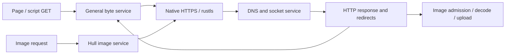

# Native download smoke

Hull's current download routes share the native rustls socket service:

| Caller | Entry point | Request identity | First connection | Redirect limit |
| --- | --- | --- | --- | --- |
| Page navigation | `netfs::fetch_bytes_happy_eyeballs` | `TRUEOS net-fetch` | IPv6/IPv4 race | 10 |
| General bytes and scripts | `netfs::fetch_bytes` | `TRUEOS net-fetch` | IPv4 | 10 |
| Retained images | `ui4_scene::hull_image_request` | `TRUEOS Hull raster/1` | IPv4 | 5 |



Successful general-byte operations retain the final transport URL from the
same GET as their bytes. `fetch_bytes_final_url` reads it without consuming
the operation; query it before the final body read. Hull adopts this URL as
the document base before resolving scripts, styles, and images. This fixes
relative assets after both host and directory redirects.

The `HTTP_FETCH_DIAG_PROFILE_ENABLED` switch controls the bounded
`download-http:` records. These records use Net/Important so the ordinary
hypervisor and graphics diagnostic profiles retain them. They include sanitized
per-hop URLs, IPv4 peers, DNS/readiness timing, response status and selected
headers, body fingerprints, and up to 1,024 bytes of denial text. A preconnected
Happy Eyeballs response identifies its peer as `preconnected`; enable Net/Info
for the separate winning-family log when that distinction is needed. Cookies
and authorization headers are excluded. Handshake timing covers TCP and TLS
readiness from the request's start. For a preconnected response, zero means
that stage completed before the measured interval.

The standalone `download-smoke` Blueprint has been removed. The parser remains
available for archived logs captured by that app; its checks below use synthetic
evidence. Native `download-http:` diagnostics remain available in the kernel.

Analyze a captured app run with the following command. This parser does not
start a drain, launch an app, fetch any URL, or reset the rig:

```sh
python3 tools/testpy/download_smoke.py --log bld/baremetal-logs/LatestOfThree.logs --output /tmp/download-smoke-native/report.json
```

The newest observed app run is selected. Missing start, case, HTTP response, or
final summary evidence fails completeness; an older successful run is never
silently substituted. Use `--run ID` only to inspect an explicitly chosen
archived run. Exact duplicate app JSON from console and semantic logs is
deduplicated, while conflicting case records fail validation.

The report associates native HTTP events between each case's begin and final
request records, following recorded redirect locations. Only matching URLs
from that redirect chain are included. This correlation uses ordered evidence
windows because the production response record has no app run/case identifier;
concurrent traffic to the same URL can make a window ambiguous, which is flagged.

`diagnostic_complete` and `http_success` are separate. A captured 403 or 429
denial can be complete evidence and remains an HTTP download failure. A page
or script returning HTTP 200 through the image service can subsequently fail
PNG/image admission; this is classified separately from HTTP failure. API
error numbers are never presented as HTTP status codes. The CLI exits zero
only for complete diagnostics with all HTTP downloads successful.

The production image path can retry HTTP 429 at most twice within its original
15-second request budget. It honors the parsed `Retry-After` minimum (at least
one second), reserves a shared wait for the destination host, and cancels its
wait when the image request is canceled. Those transitions emit an explicit
`download-http:` retry record with URL, one-based retry ordinal, actual reserved
delay, Retry-After minimum, elapsed time, remaining time, and total budget.
The marker also records time already elapsed since receiving HTTP 429. The
scheduled delay plus that elapsed time must meet the Retry-After minimum;
for example, 2 ms already elapsed plus a 998 ms delay satisfies 1000 ms.

The parser accepts multiple attempts only when each earlier HTTP 429 has a
matching URL retry marker before the next response. It validates the two-retry
limit, Retry-After minimum and remaining budget. A missing marker, wrong URL,
unaccounted delay, or later response outside that transition is ambiguous and
fails completeness. A retry marker followed by cancellation and no response
also remains incomplete evidence. All response bodies, statuses, and retry
records remain in the report.
Retry ordinals and the two-retry limit span the entire redirect chain. A
shared host cooldown extended by another worker can emit `image_backoff`
with reason `cooldown-extended`; these wait records remain in `http_events`
and do not consume an additional retry ordinal.

`http_failures` counts cases whose final HTTP response fails. A recovered 429
is counted separately in `recovered_http_failures` when the case ultimately
receives HTTP success. `retried_http_failures` counts earlier denials that led
to an evidenced retry even when the final response still fails, and
`http_failure_responses` counts all denial responses. A final HTTP 429 always
remains a failed download.

Selected response headers, bounded denial-body previews, remote peers,
User-Agent profiles, body hashes, and recorded handshake/first-byte/total
timings remain in the JSON. Successful general-byte responses must match the
kernel body fingerprint when no content decoding changes the byte stream.
Their final URL metadata is checked against the terminal HTTP response when
the app records it; the app queries this metadata before consuming the body.
Per-case cycle timings remain raw unless independently calibrated; the app's
microsecond values have 1 ms resolution.

Parser checks use synthetic evidence and make no network requests:

```sh
python3 tools/testpy/test_download_smoke.py
```
